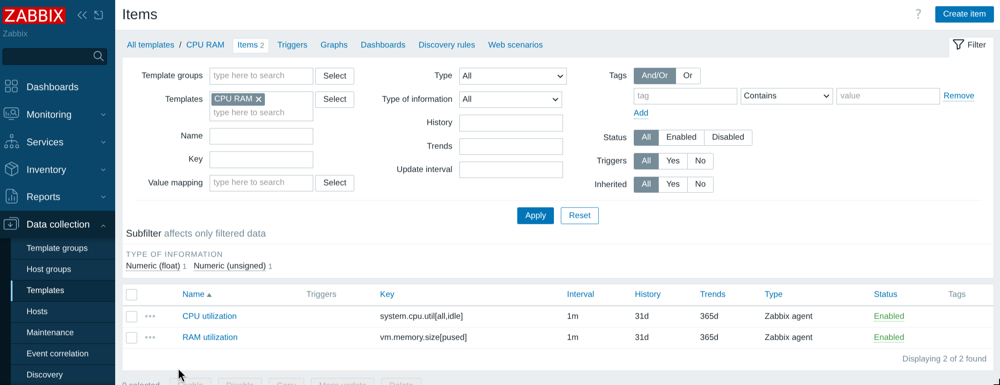
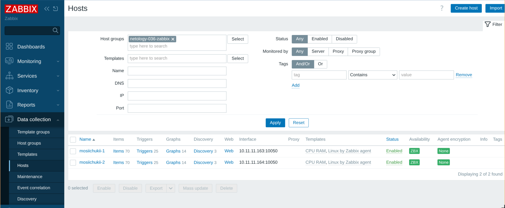
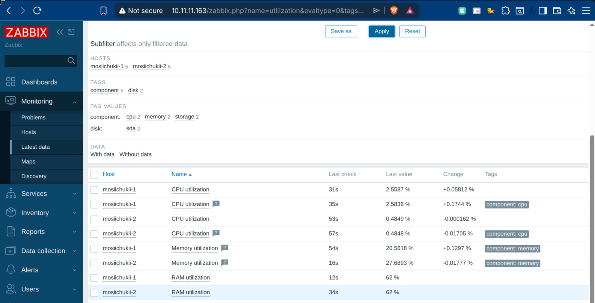
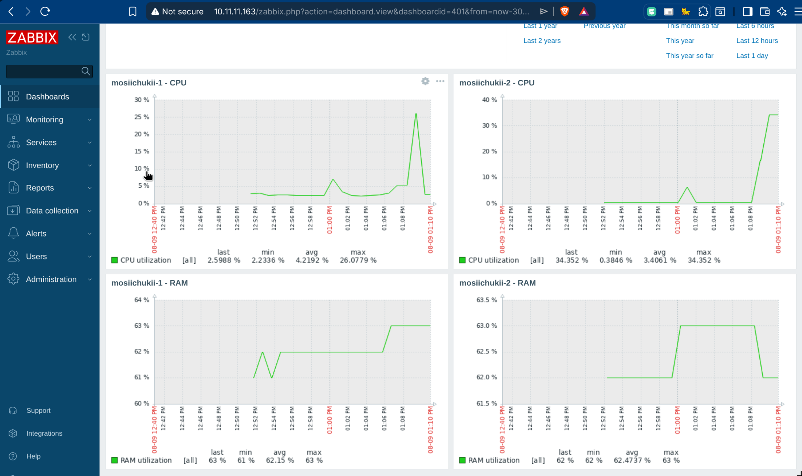
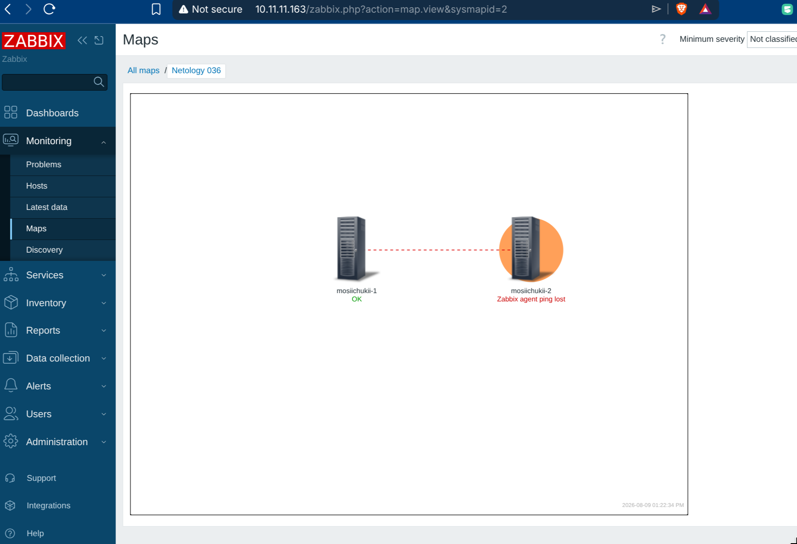
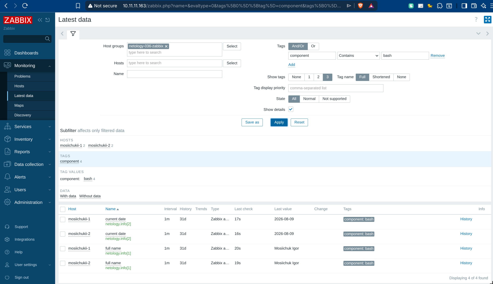
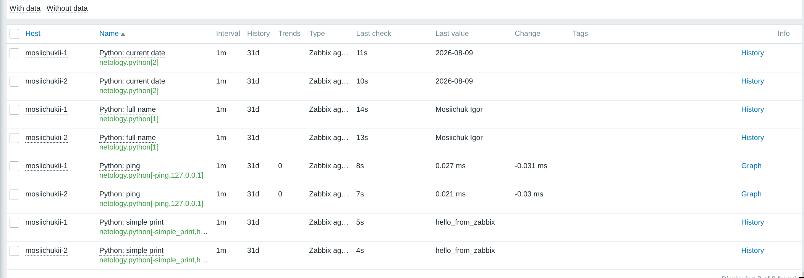
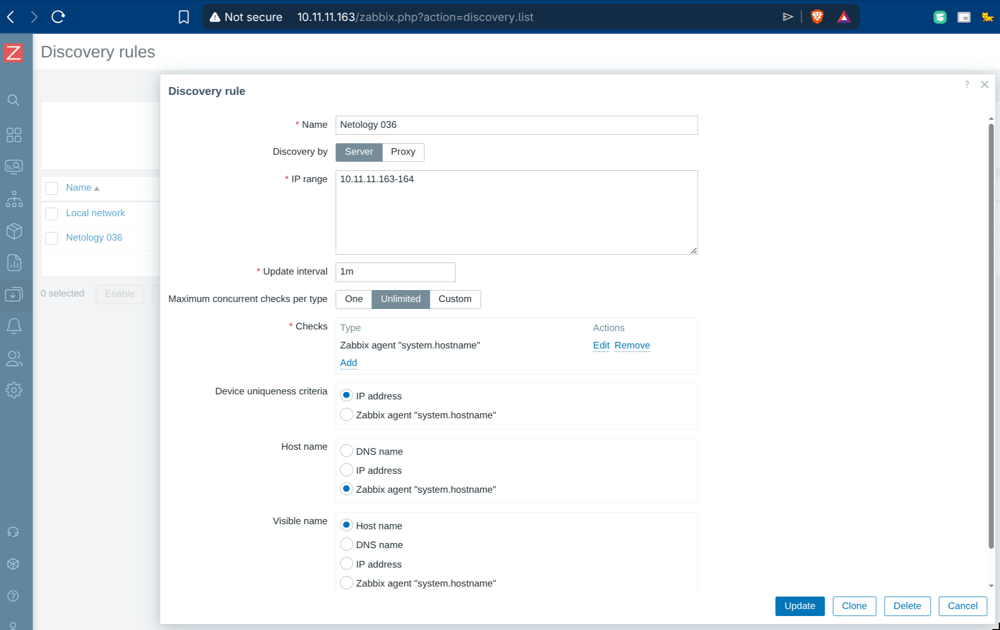
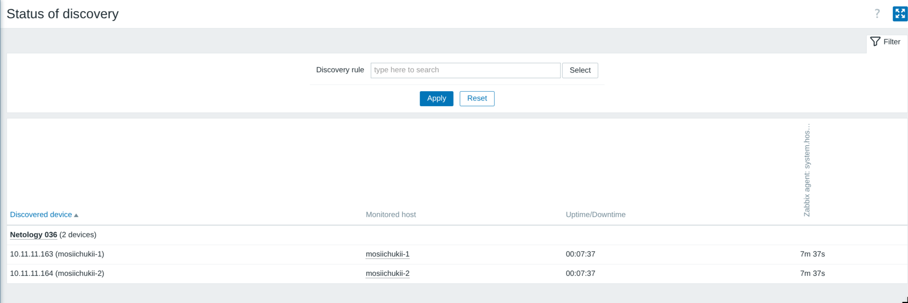
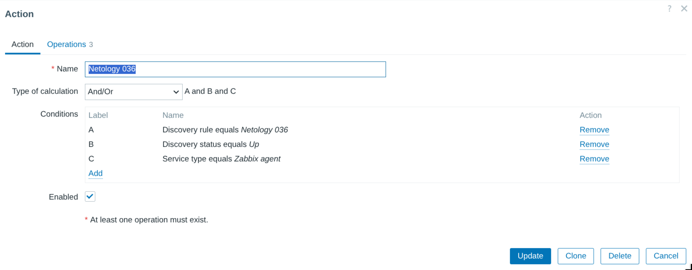

# Домашнее задание к занятию «Система мониторинга Zabbix. Часть 2»

Студент: Игорь Мосиичук

## О работе

Для выполнения заданий используются две виртуальные машины с Debian 13.

Инфраструктура создаётся Terraform, установка и настройка Zabbix Server, PostgreSQL, frontend и Zabbix Agent 2 выполняются Ansible.

Используется Zabbix 7.0 LTS.

## Структура

```text
.
├── README.md
├── ansible/
│   ├── ansible.cfg
│   └── site.yml
├── docs/
│   └── screenshots/
├── scripts/
│   ├── zabbix-userparameter.py
│   └── zabbix-userparameter.sh
└── terraform/
    ├── .terraform.lock.hcl
    ├── main.tf
    ├── providers.tf
    ├── templates/
    │   └── user-data.yaml.tftpl
    └── versions.tf
```

## Задание 1

Создан шаблон `CPU RAM` с двумя элементами данных:

- `CPU utilization` — `system.cpu.util[all,idle]`, загрузка рассчитывается как `100 - idle` через простой JavaScript;
- `RAM utilization` — `vm.memory.size[pused]`.



## Задания 2–3

Добавлены два хоста:

- `mosiichukii-1` — `10.11.11.163`;
- `mosiichukii-2` — `10.11.11.164`.

На обеих VM установлен Zabbix Agent 2. К обоим хостам привязаны шаблоны:

- `Linux by Zabbix agent`;
- `CPU RAM`.

Оба агента доступны серверу и передают данные.



Поступление данных из созданного шаблона:



## Задание 4

Создан отдельный dashboard с графиками CPU и RAM для обоих хостов.



## Задание 5*

Создана карта с двумя хостами и связью между ними.

Для `mosiichukii-2` добавлен триггер:

```text
nodata(/mosiichukii-2/agent.ping,2m)=1
```

При недоступности агента связь между хостами отображается красной пунктирной линией.



## Задание 6*

Добавлен Bash UserParameter:

```text
netology.info[*]
```

Скрипт возвращает имя при аргументе `1` и текущую дату при аргументе `2`.

<details>
<summary>zabbix-userparameter.sh</summary>

```bash
#!/usr/bin/env bash
set -euo pipefail

case "${1:-}" in
  1)
    printf '%s\n' 'Mosiichuk Igor'
    ;;
  2)
    date '+%Y-%m-%d'
    ;;
  *)
    printf 'Usage: %s {1|2}\n' "$0" >&2
    exit 1
    ;;
esac
```

</details>

Файл: [scripts/zabbix-userparameter.sh](scripts/zabbix-userparameter.sh)

Результат работы UserParameter:



## Задание 7*

Доработан Python-скрипт из лекции. Поддерживаются:

- `1` — имя;
- `2` — текущая дата;
- `-ping` — время ответа узла;
- `-simple_print` — вывод переданного текста.

UserParameter:

```text
netology.python[*]
```

<details>
<summary>zabbix-userparameter.py</summary>

```python
#!/usr/bin/env python3

import re
import subprocess
import sys
from datetime import date


FULL_NAME = "Mosiichuk Igor"


def ping(target: str) -> None:
    result = subprocess.run(
        ["ping", "-c", "1", "-W", "2", target],
        capture_output=True,
        text=True,
        check=False,
    )

    if result.returncode != 0:
        print(f"ping failed for {target}", file=sys.stderr)
        raise SystemExit(1)

    match = re.search(r"time[=<]([\d.]+)\s*ms", result.stdout)

    if not match:
        print("ping latency not found", file=sys.stderr)
        raise SystemExit(1)

    print(match.group(1))


def main() -> None:
    if len(sys.argv) < 2:
        print("missing argument", file=sys.stderr)
        raise SystemExit(1)

    command = sys.argv[1]

    if command == "1":
        print(FULL_NAME)

    elif command == "2":
        print(date.today().isoformat())

    elif command == "-ping":
        if len(sys.argv) < 3 or not sys.argv[2]:
            print("missing ping target", file=sys.stderr)
            raise SystemExit(1)

        ping(sys.argv[2])

    elif command == "-simple_print":
        if len(sys.argv) < 3:
            print("missing text", file=sys.stderr)
            raise SystemExit(1)

        print(sys.argv[2])

    else:
        print(f"unknown input: {command}")


if __name__ == "__main__":
    main()
```

</details>

Файл: [scripts/zabbix-userparameter.py](scripts/zabbix-userparameter.py)

Результат работы четырёх режимов:



## Задание 8*

Настроено сетевое обнаружение Zabbix Agent 2 в диапазоне:

```text
10.11.11.163-164
```

Для проверки используется Zabbix agent item:

```text
system.hostname
```

Имя обнаруженного хоста берётся из результата `system.hostname`.



Результат обнаружения обоих хостов:



Также настроено discovery action для найденных Zabbix Agent:

- добавление хоста;
- добавление в группу `netology-036-zabbix`;
- привязка шаблонов `CPU RAM` и `Linux by Zabbix agent`.



## Задание 9*

Вместо Vagrant стенд развёрнут в Proxmox с помощью Terraform.

Terraform создаёт две VM, а Ansible устанавливает и настраивает Zabbix Agent 2 и разработанные в заданиях 6–7 UserParameter.

Агенты настроены для работы с Zabbix Server и готовы к сетевому обнаружению из задания 8.

Основные файлы:

- [terraform/main.tf](terraform/main.tf);
- [terraform/providers.tf](terraform/providers.tf);
- [terraform/templates/user-data.yaml.tftpl](terraform/templates/user-data.yaml.tftpl);
- [ansible/site.yml](ansible/site.yml);
- [scripts/zabbix-userparameter.sh](scripts/zabbix-userparameter.sh);
- [scripts/zabbix-userparameter.py](scripts/zabbix-userparameter.py).
