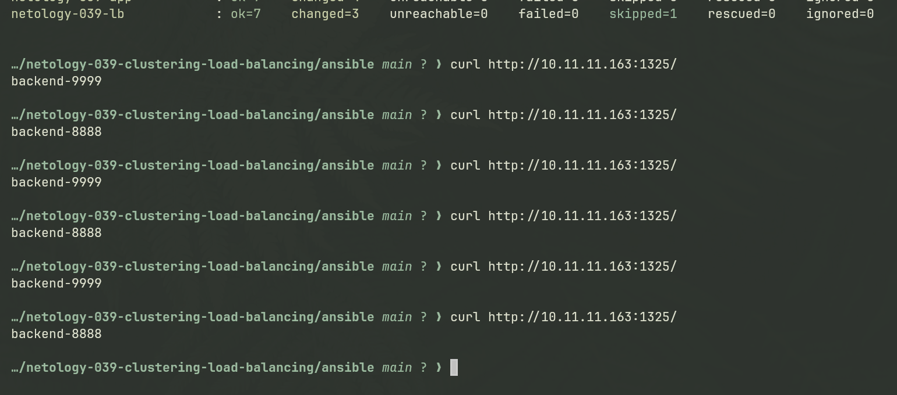
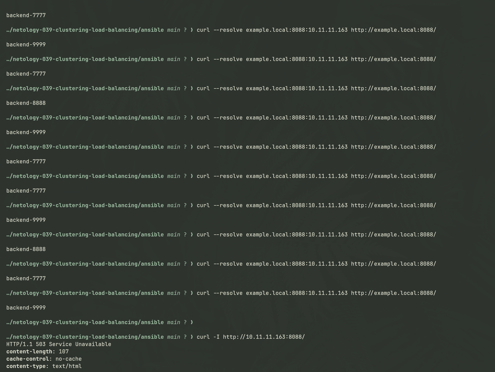
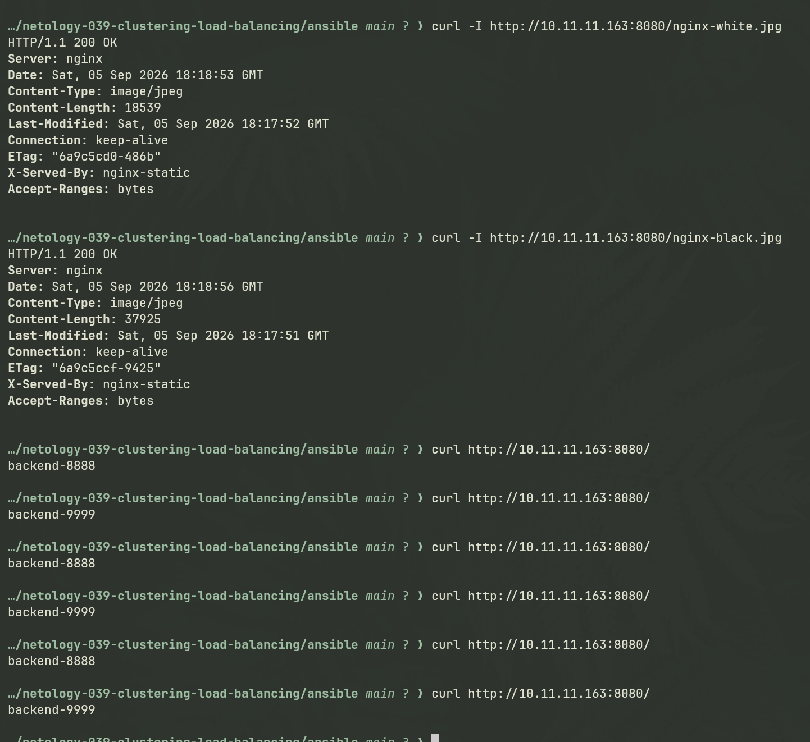
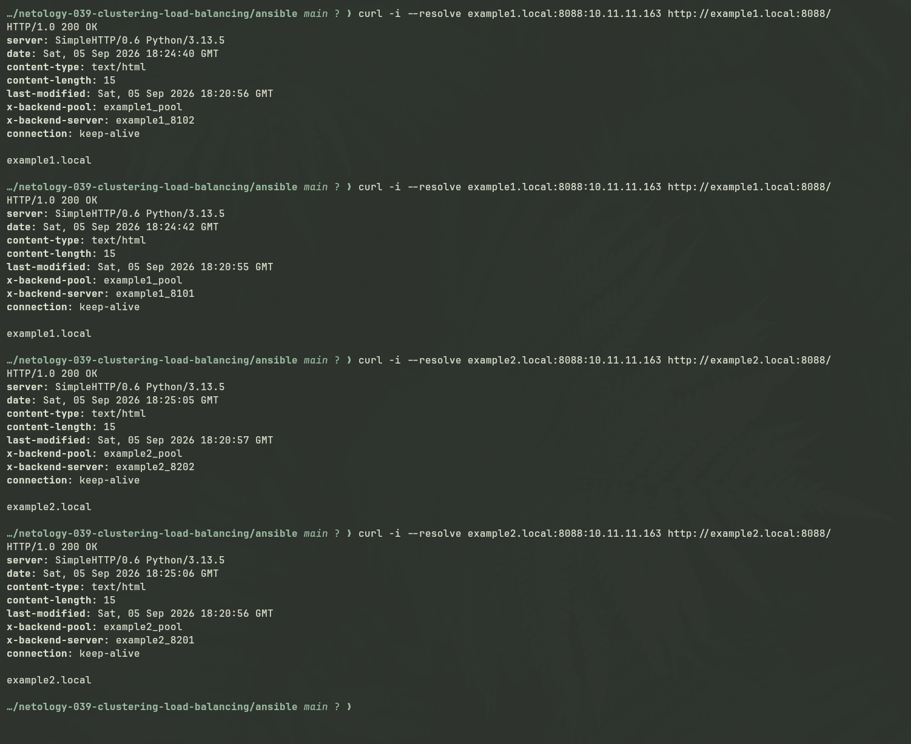

# Домашнее задание к занятию «Кластеризация и балансировка нагрузки»

Студент: Игорь Мосиичук

## О работе

Для выполнения заданий используются две виртуальные машины с Debian 13:

- `netology-039-lb` — HAProxy и Nginx;
- `netology-039-app` — Python HTTP backends.

Инфраструктура создаётся Terraform. Имена и IP-адреса VM берутся из Terraform outputs, после чего [scripts/render-inventory.sh](scripts/render-inventory.sh) генерирует `ansible/inventory.yml`.

Ansible устанавливает и настраивает необходимые сервисы. Python backends запускаются через общий systemd template [configs/systemd/netology-http@.service](configs/systemd/netology-http@.service), а HAProxy получает адрес application VM из сгенерированного inventory.

Основные файлы инфраструктуры:

- [terraform/main.tf](terraform/main.tf);
- [terraform/outputs.tf](terraform/outputs.tf);
- [scripts/render-inventory.sh](scripts/render-inventory.sh);
- [configs/systemd/netology-http@.service](configs/systemd/netology-http@.service).

Оригинальное условие: [netology-code/sflt-homeworks — 2.md](https://github.com/netology-code/sflt-homeworks/blob/main/2.md)

## Задание 1

Условие

- Запустите два simple python сервера на своей виртуальной машине на разных портах
- Установите и настройте HAProxy, воспользуйтесь материалами к лекции по [ссылке](2/)
- Настройте балансировку Round-robin на 4 уровне.
- На проверку направьте конфигурационный файл haproxy, скриншоты, где видно перенаправление запросов на разные серверы при обращении к HAProxy.

### Решение

HAProxy настроен в режиме L4 (`mode tcp`) и принимает соединения на порту `1325`.

Два Python backend работают на портах `8888` и `9999`. Новые TCP-соединения распределяются между ними алгоритмом `roundrobin`.

Конфигурация:

[configs/haproxy/01-task1.cfg.j2](configs/haproxy/01-task1.cfg.j2)

Результат:

## Задание 2

Условие

- Запустите три simple python сервера на своей виртуальной машине на разных портах
- Настройте балансировку Weighted Round Robin на 7 уровне, чтобы первый сервер имел вес 2, второй - 3, а третий - 4
- HAproxy должен балансировать только тот http-трафик, который адресован домену example.local
- На проверку направьте конфигурационный файл haproxy, скриншоты, где видно перенаправление запросов на разные серверы при обращении к HAProxy c использованием домена example.local и без него.

### Решение

HAProxy работает на уровне HTTP и балансирует запросы для `example.local` между тремя backend:

- `8888` — weight `2`;
- `9999` — weight `3`;
- `7777` — weight `4`.

ACL по заголовку `Host` разрешает маршрутизацию только для `example.local`; запрос без подходящего Host не выбирает backend и получает `503`.

Конфигурация:

[configs/haproxy/02-task2.cfg.j2](configs/haproxy/02-task2.cfg.j2)

Результат:

## Задание 3*

Условие

- Настройте связку HAProxy + Nginx как было показано на лекции.
- Настройте Nginx так, чтобы файлы .jpg выдавались самим Nginx (предварительно разместите несколько тестовых картинок в директории /var/www/), а остальные запросы переадресовывались на HAProxy, который в свою очередь переадресовывал их на два Simple Python server.
- На проверку направьте конфигурационные файлы nginx, HAProxy, скриншоты с запросами jpg картинок и других файлов на Simple Python Server, демонстрирующие корректную настройку.

### Решение

Nginx используется как внешний HTTP-сервер на порту `8080`.

Запросы к `.jpg` Nginx обслуживает самостоятельно из `/var/www`. Остальные запросы передаются во внутренний HAProxy на `127.0.0.1:8090`, который распределяет их между Python backend `8888` и `9999` алгоритмом round-robin.

Конфигурации:

- [configs/nginx/03-task3.conf.j2](configs/nginx/03-task3.conf.j2);
- [configs/haproxy/03-task3.cfg.j2](configs/haproxy/03-task3.cfg.j2).

Результат:

## Задание 4*

Условие

- Запустите 4 simple python сервера на разных портах.
- Первые два сервера будут выдавать страницу index.html вашего сайта example1.local (в файле index.html напишите example1.local)
- Вторые два сервера будут выдавать страницу index.html вашего сайта example2.local (в файле index.html напишите example2.local)
- Настройте два бэкенда HAProxy
- Настройте фронтенд HAProxy так, чтобы в зависимости от запрашиваемого сайта example1.local или example2.local запросы перенаправлялись на разные бэкенды HAProxy
- На проверку направьте конфигурационный файл HAProxy, скриншоты, демонстрирующие запросы к разным фронтендам и ответам от разных бэкендов.

### Решение

HAProxy маршрутизирует HTTP-запросы по заголовку `Host` в два независимых backend pool:

- `example1.local` → backend `8101` и `8102`;
- `example2.local` → backend `8201` и `8202`.

Внутри каждого pool используется round-robin. Сначала HAProxy выбирает группу серверов по имени сайта, а затем конкретный backend внутри этой группы.

Конфигурация:

[configs/haproxy/04-task4.cfg.j2](configs/haproxy/04-task4.cfg.j2)

Результат:

