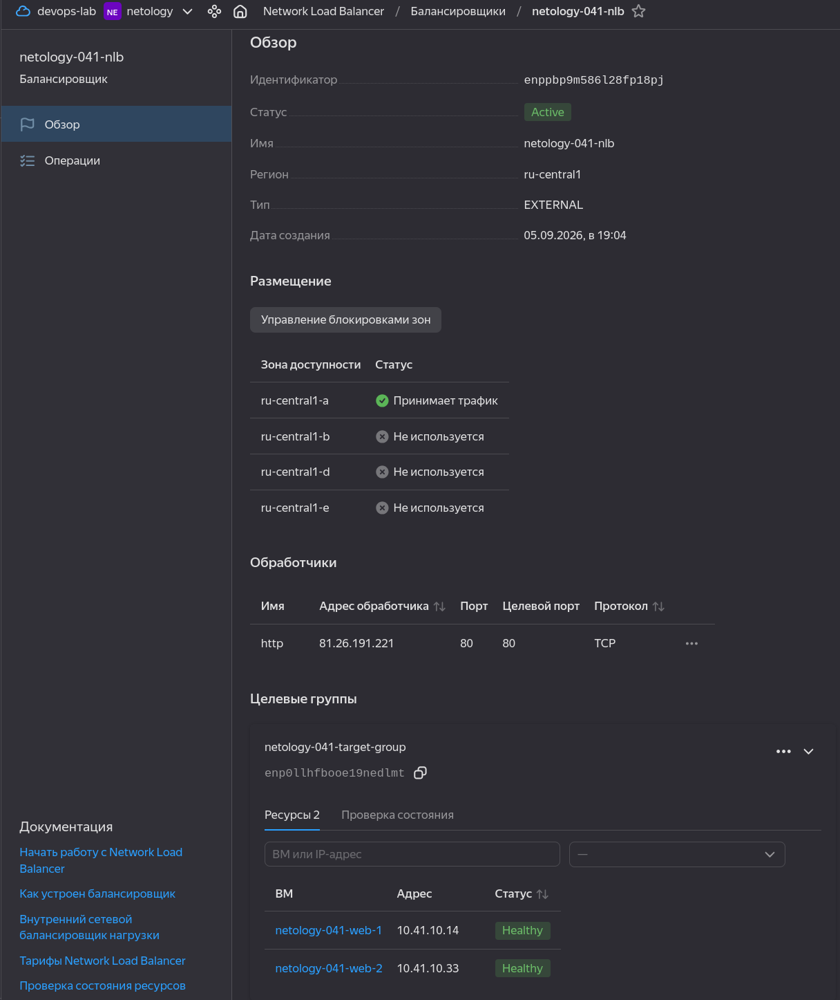
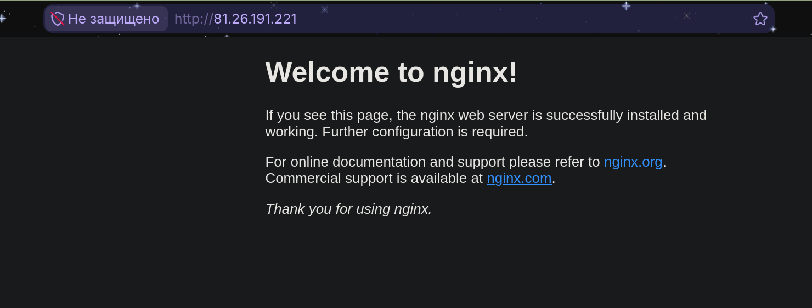
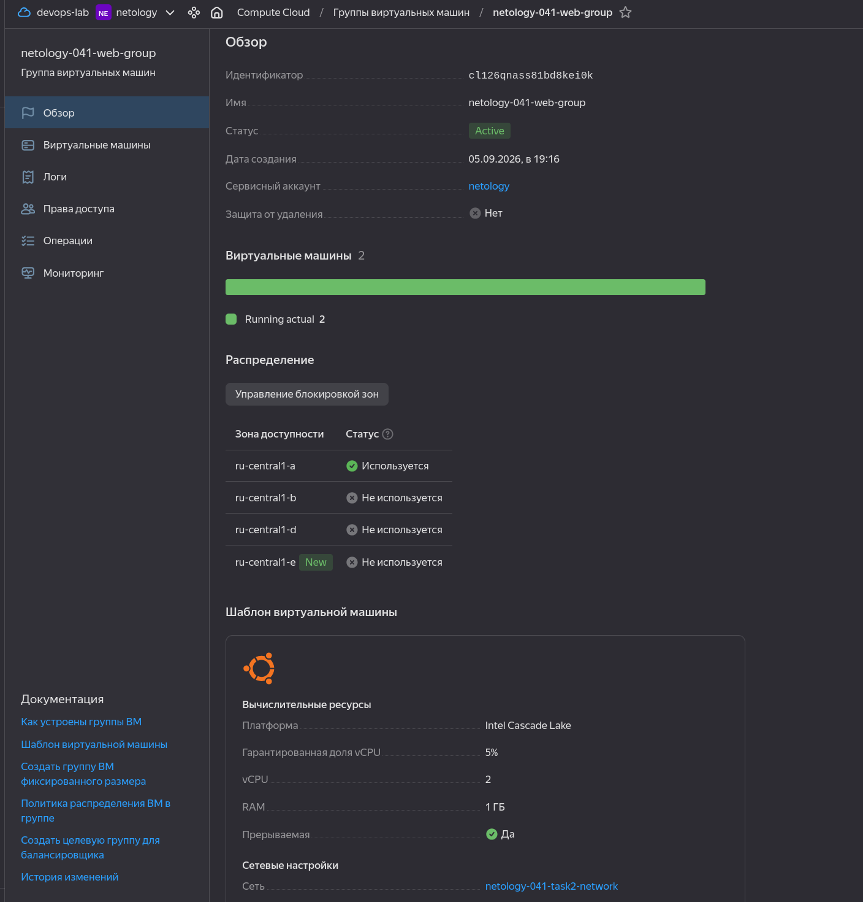
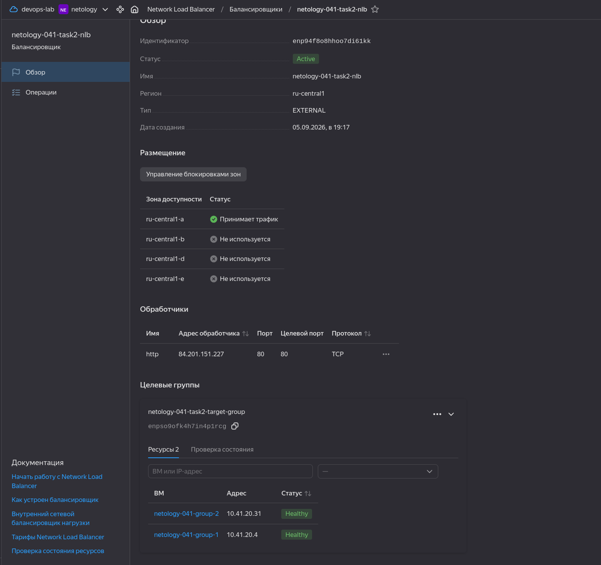
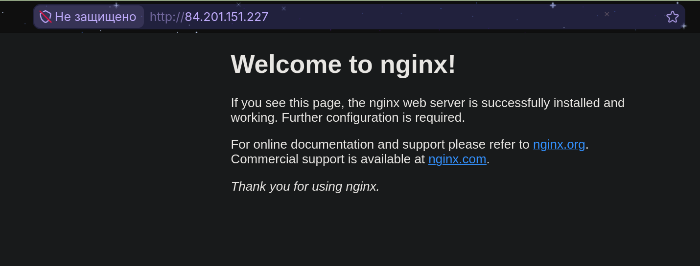

# Домашнее задание к занятию «Отказоустойчивость в облаке»

Студент: Игорь Мосиичук

## О работе

Инфраструктура развёрнута в Yandex Cloud с помощью Terraform.

Terraform создаёт виртуальные машины, сеть, целевые группы и Network Load Balancer. Nginx устанавливается автоматически через `cloud-init`, поэтому отдельный этап ручной настройки VM не требуется.

Оригинальное условие: [netology-code/sflt-homeworks — 4.md](https://github.com/netology-code/sflt-homeworks/blob/main/4.md)

## Задание 1

Условие

Возьмите за основу [решение к заданию 1 из занятия «Подъём инфраструктуры в Яндекс Облаке»](https://github.com/netology-code/sdvps-homeworks/blob/main/7-03.md#задание-1).

1. Теперь вместо одной виртуальной машины сделайте terraform playbook, который:

- создаст 2 идентичные виртуальные машины. Используйте аргумент [count](https://www.terraform.io/docs/language/meta-arguments/count.html) для создания таких ресурсов;
- создаст [таргет-группу](https://registry.terraform.io/providers/yandex-cloud/yandex/latest/docs/resources/lb_target_group). Поместите в неё созданные на шаге 1 виртуальные машины;
- создаст [сетевой балансировщик нагрузки](https://registry.terraform.io/providers/yandex-cloud/yandex/latest/docs/resources/lb_network_load_balancer), который слушает на порту 80, отправляет трафик на порт 80 виртуальных машин и http healthcheck на порт 80 виртуальных машин.

Рекомендуем изучить [документацию сетевого балансировщика нагрузки](https://cloud.yandex.ru/docs/network-load-balancer/quickstart) для того, чтобы было понятно, что вы сделали.

2. Установите на созданные виртуальные машины пакет Nginx любым удобным способом и запустите Nginx веб-сервер на порту 80.

3. Перейдите в веб-консоль Yandex Cloud и убедитесь, что: 

- созданный балансировщик находится в статусе Active,
- обе виртуальные машины в целевой группе находятся в состоянии healthy.

4. Сделайте запрос на 80 порт на внешний IP-адрес балансировщика и убедитесь, что вы получаете ответ в виде дефолтной страницы Nginx.

*В качестве результата пришлите:*

*1. Terraform Playbook.*

*2. Скриншот статуса балансировщика и целевой группы.*

*3. Скриншот страницы, которая открылась при запросе IP-адреса балансировщика.*

### Решение

Созданы две одинаковые виртуальные машины через `count`.

На обеих VM автоматически устанавливается Nginx. Внутренние IP-адреса машин добавляются в Target Group, которая подключена к внешнему Network Load Balancer.

Балансировщик принимает HTTP-трафик на порту `80` и передаёт его на порт `80` одной из двух VM. Состояние backend проверяется HTTP health check по пути `/`.

Основные конфигурации:

- [terraform/task1/compute.tf](terraform/task1/compute.tf);
- [terraform/task1/load-balancer.tf](terraform/task1/load-balancer.tf);
- [terraform/task1/network.tf](terraform/task1/network.tf);
- [terraform/task1/templates/nginx-cloud-init.yml](terraform/task1/templates/nginx-cloud-init.yml).

Балансировщик активен, обе VM в целевой группе имеют статус `Healthy`:

Страница Nginx доступна через внешний IP балансировщика:

## Задание 2*

Условие

1. Теперь вместо создания виртуальных машин создайте [группу виртуальных машин с балансировщиком нагрузки](https://cloud.yandex.ru/docs/compute/operations/instance-groups/create-with-balancer).

2. Nginx нужно будет поставить тоже автоматизированно. Для этого вам нужно будет подложить файл установки Nginx в user-data-ключ [метадаты](https://cloud.yandex.ru/docs/compute/concepts/vm-metadata) виртуальной машины.

- [Пример файла установки Nginx](https://github.com/nar3k/yc-public-tasks/blob/master/terraform/metadata.yaml).
- [Как подставлять файл в метадату виртуальной машины.](https://github.com/nar3k/yc-public-tasks/blob/a6c50a5e1d82f27e6d7f3897972adb872299f14a/terraform/main.tf#L38)

3. Перейдите в веб-консоль Yandex Cloud и убедитесь, что: 

- созданный балансировщик находится в статусе Active,
- обе виртуальные машины в целевой группе находятся в состоянии healthy.

4. Сделайте запрос на 80 порт на внешний IP-адрес балансировщика и убедитесь, что вы получаете ответ в виде дефолтной страницы Nginx.

*В качестве результата пришлите*

*1. Terraform Playbook.*

*2. Скриншот статуса балансировщика и целевой группы.*

*3. Скриншот страницы, которая открылась при запросе IP-адреса балансировщика.*

### Решение

Вместо отдельных виртуальных машин используется Yandex Compute Instance Group.

Группа поддерживает фиксированное количество из двух VM. Обе машины создаются из одного шаблона, а Nginx устанавливается через `user-data`.

Instance Group автоматически формирует Target Group для Network Load Balancer. Балансировщик принимает трафик на порту `80`, распределяет его между экземплярами группы и проверяет их доступность HTTP health check.

Основные конфигурации:

- [terraform/task2/instance-group.tf](terraform/task2/instance-group.tf);
- [terraform/task2/load-balancer.tf](terraform/task2/load-balancer.tf);
- [terraform/task2/network.tf](terraform/task2/network.tf);
- [terraform/task2/templates/nginx-cloud-init.yml](terraform/task2/templates/nginx-cloud-init.yml).

Instance Group содержит две работающие VM:

Network Load Balancer активен, обе цели имеют статус `Healthy`:

Страница Nginx доступна через внешний IP балансировщика:

