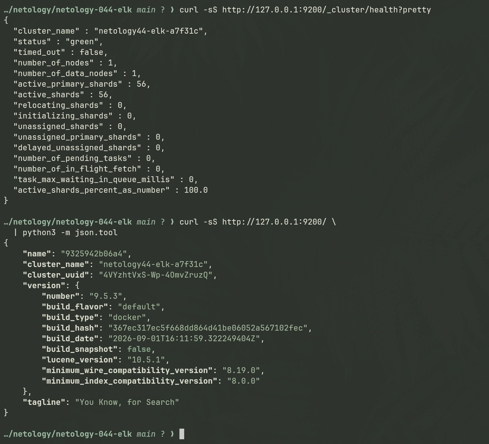
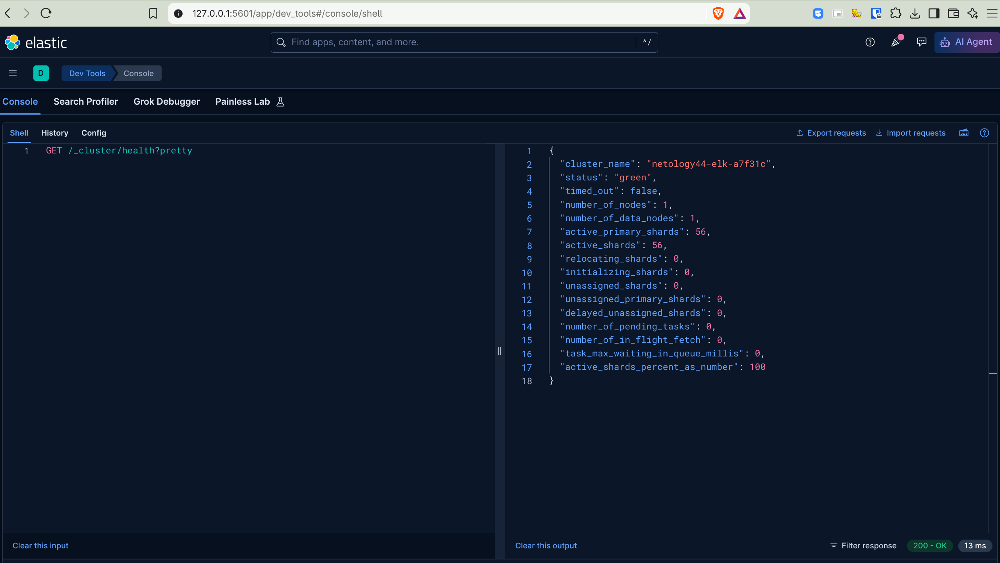
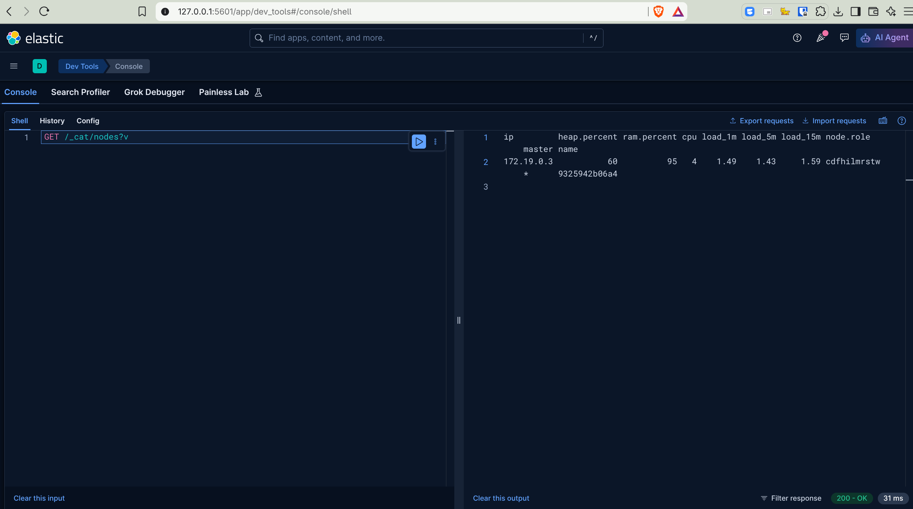
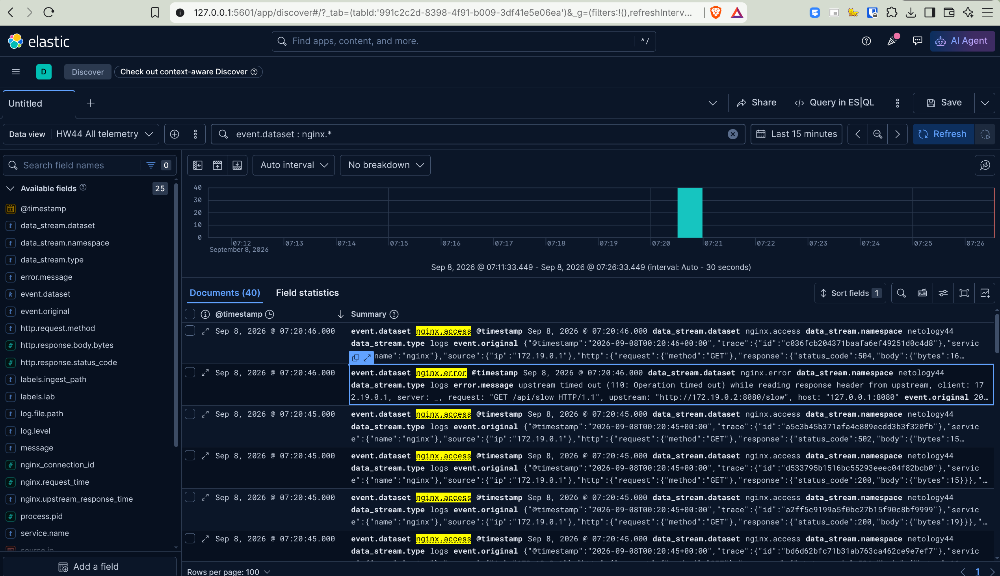
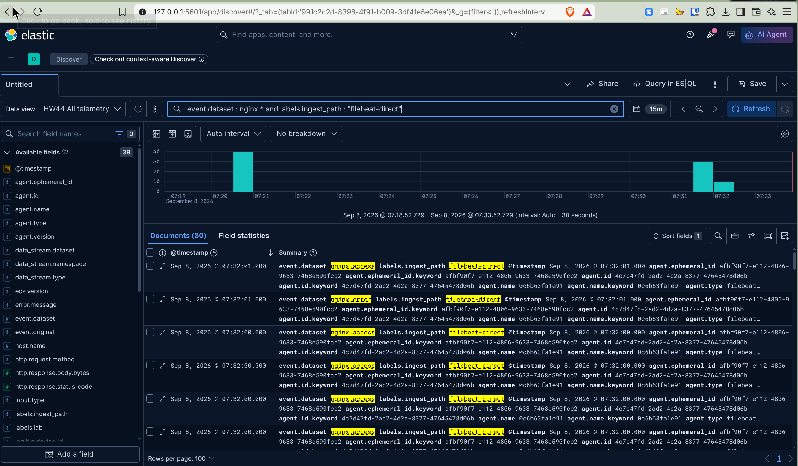
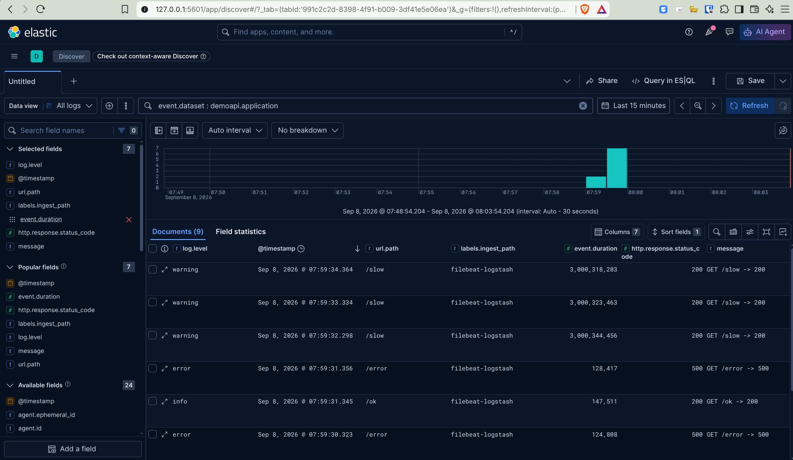
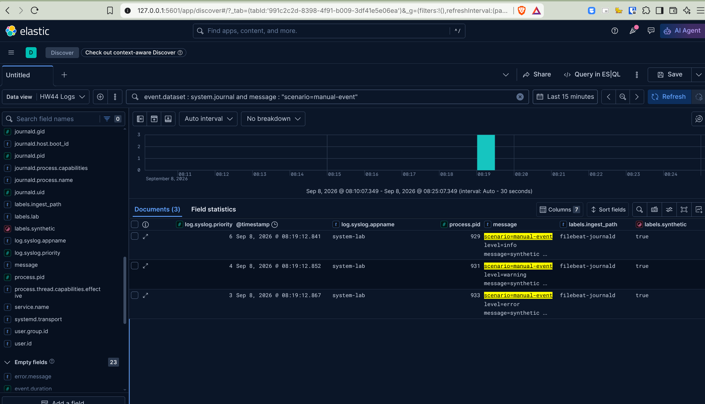
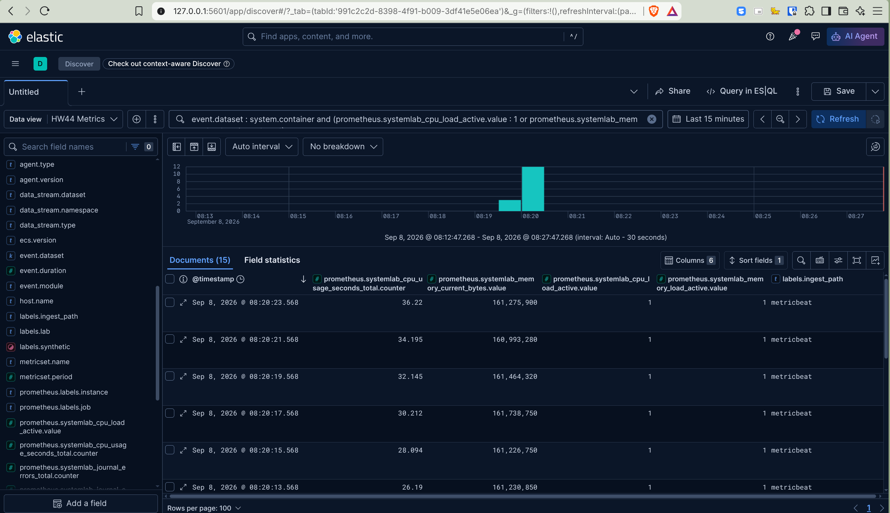
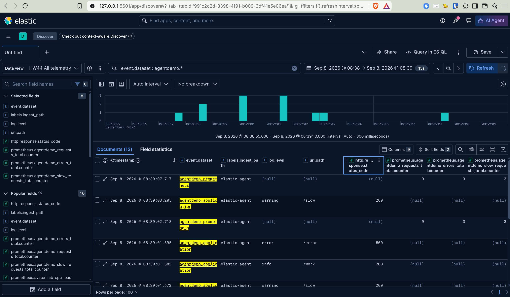

# Домашнее задание к занятию «ELK»

Студент: Игорь Мосиичук

## О работе

Для домашней работы собран локальный стенд на Elastic Stack 9.5.3: Elasticsearch, Kibana, Logstash и Filebeat запускаются через Docker Compose.

Основные задания выполнены на одном источнике — Nginx. Сначала access-лог отправляется в Elasticsearch через Logstash, затем тот же поток переключается на Filebeat. В задании 5* добавлен отдельный `demo-api`, чтобы проверить цепочку Filebeat → Logstash → Elasticsearch уже на другом формате логов.

В обязательной части основной акцент был на настройке формата событий, парсинге и маршрутах доставки. Дополнительно добавил `journald`, Metricbeat и standalone Elastic Agent, чтобы отдельно посмотреть сбор системных событий и метрик.

Оригинальное условие: [netology-code/sdb-homeworks — 11-03.md](https://github.com/netology-code/sdb-homeworks/blob/main/11-03.md)

---

## Задание 1. Elasticsearch

<details>
<summary>Условие</summary>

Установите и запустите Elasticsearch, после чего поменяйте параметр cluster_name на случайный. 

*Приведите скриншот команды 'curl -X GET 'localhost:9200/_cluster/health?pretty', сделанной на сервере с установленным Elasticsearch. Где будет виден нестандартный cluster_name*.

</details>

### Решение

Elasticsearch запущен в `single-node` режиме. Имя кластера изменено на:

```text
netology44-elk-a7f31c
```

Конфигурация стенда находится в [compose.yml](compose.yml).

Проверка `_cluster/health` показала состояние `green` и нестандартное имя кластера.



---

## Задание 2. Kibana

<details>
<summary>Условие</summary>

Установите и запустите Kibana.

*Приведите скриншот интерфейса Kibana на странице http://<ip вашего сервера>:5601/app/dev_tools#/console, где будет выполнен запрос GET /_cluster/health?pretty*.

</details>

### Решение

Kibana подключена к тому же Elasticsearch. В Dev Tools выполнен запрос:

```http
GET /_cluster/health?pretty
```



Дополнительно проверил узел Elasticsearch через `_cat/nodes`.



---

## Задание 3. Logstash

<details>
<summary>Условие</summary>

Установите и запустите Logstash и Nginx. С помощью Logstash отправьте access-лог Nginx в Elasticsearch. 

*Приведите скриншот интерфейса Kibana, на котором видны логи Nginx.*

</details>

### Решение

Для access-лога Nginx настроен JSON-формат. Так Logstash получает уже структурированное событие и не тратит отдельный фильтр на разбор стандартной строки access log.

Конфигурация Nginx: [nginx/nginx.conf](nginx/nginx.conf).

Logstash читает два файла:

- `netology-access.log` — JSON access log;
- `netology-error.log` — обычный текстовый error log.

Для `nginx.access` используется JSON filter, для `nginx.error` — Grok + Date. После разбора события приводятся к ECS-подобной структуре и записываются в отдельные data streams.

Конфигурация pipeline: [logstash/pipeline/nginx.conf](logstash/pipeline/nginx.conf).

Для проверки пути доставки добавлено поле:

```text
labels.ingest_path = logstash-direct
```

На скриншоте видны access и error события Nginx, включая 4xx/5xx и ошибки upstream.



> Стандартные `/var/log/nginx/access.log` и `error.log` в официальном Docker image Nginx являются ссылками на stdout/stderr. Для общего named volume между Nginx и collectors использовал отдельные обычные файлы `netology-access.log` и `netology-error.log`.

---

## Задание 4. Filebeat

<details>
<summary>Условие</summary>

Установите и запустите Filebeat. Переключите поставку логов Nginx с Logstash на Filebeat. 

*Приведите скриншот интерфейса Kibana, на котором видны логи Nginx, которые были отправлены через Filebeat.*

</details>

### Решение

Для второго варианта доставки тот же Nginx volume читает Filebeat.

Access log разбирается `filestream` + NDJSON parser и отправляется напрямую в Elasticsearch.

Error log остаётся текстовым и проходит через Elasticsearch ingest pipeline `netology44-nginx-error`.

Основные конфиги:

- [filebeat/nginx.yml](filebeat/nginx.yml);
- [elasticsearch/bootstrap/nginx-error-pipeline.json](elasticsearch/bootstrap/nginx-error-pipeline.json).

Для отличия от предыдущего варианта:

```text
labels.ingest_path = filebeat-direct
```

В Kibana видны те же Nginx события, но уже с маршрутом через Filebeat.



---

## Дополнительные задания (со звёздочкой*)

### Задание 5*. Доставка данных

<details>
<summary>Условие</summary>

Настройте поставку лога в Elasticsearch через Logstash и Filebeat любого другого сервиса , но не Nginx. 
Для этого лог должен писаться на файловую систему, Logstash должен корректно его распарсить и разложить на поля. 

*Приведите скриншот интерфейса Kibana, на котором будет виден этот лог и напишите лог какого приложения отправляется.*

</details>

### Решение

В качестве второго источника использован небольшой `demo-api`.

Приложение пишет JSONL в файл:

```text
/var/log/demo-api/application.jsonl
```

Filebeat здесь используется только как shipper и отправляет исходную строку в Logstash. Парсинг JSON, нормализация полей и назначение data stream выполняются уже в Logstash — это позволяет отдельно проверить именно его filter stage.

Основные конфиги:

- [filebeat/demo-api.yml](filebeat/demo-api.yml);
- [logstash/pipeline/demo-api.conf](logstash/pipeline/demo-api.conf);
- [demo-api/app.py](demo-api/app.py).

Итоговый data stream:

```text
logs-demoapi.application-netology44
```

Для проверки были сгенерированы обычные, ошибочные и медленные запросы. В результате в Kibana видны `log.level`, HTTP status, URL, `event.duration`, `trace.id` и сообщение приложения.



---

## Дополнительная лаборатория

После основной части немного расширил стенд. Эти проверки не требуются условием домашней работы.

### Journald → Filebeat

В отдельном `system-lab` контейнере работает собственный `systemd-journald`. Filebeat читает только журнал этого контейнера и фильтрует записи по:

```text
SYSLOG_IDENTIFIER=system-lab
```

Так удалось проверить `journald` input без подключения системного журнала рабочей станции.



### Prometheus → Metricbeat

`system-lab` также публикует Prometheus endpoint с CPU/memory метриками и состоянием синтетической нагрузки.

Metricbeat собирает эти значения через `prometheus/collector`. На скриншоте виден интервал, когда одновременно активны CPU и memory load.



### Standalone Elastic Agent

Для знакомства с текущим Elastic Agent добавлен отдельный `agent-demo`, который одновременно:

- пишет JSONL application log;
- отдаёт Prometheus metrics.

Standalone Elastic Agent собирает оба потока одним конфигом:

```text
filestream          → agentdemo.application
prometheus/metrics  → agentdemo.prometheus
```

Agent работает локально, без Fleet. На скриншоте одновременно видны application logs и metrics, пришедшие через один Agent.



---

## Итог

В рамках работы проверены три основных варианта доставки логов:

```text
Nginx    → Logstash                  → Elasticsearch
Nginx    → Filebeat                  → Elasticsearch
demo-api → Filebeat → Logstash       → Elasticsearch
```

Дополнительно проверены `journald`, Metricbeat и standalone Elastic Agent.

Для Elasticsearch использованы отдельные data streams, а события приведены к одинаковой ECS-подобной структуре, чтобы их было удобно сравнивать в Kibana.
