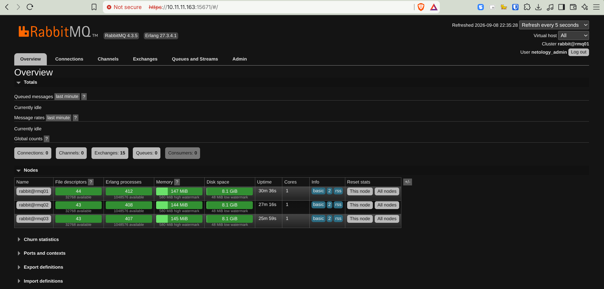
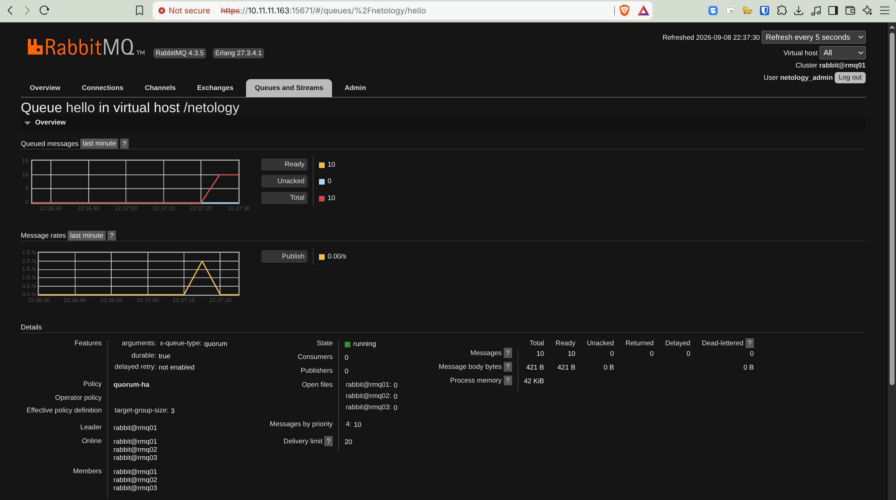
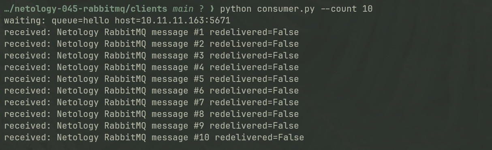
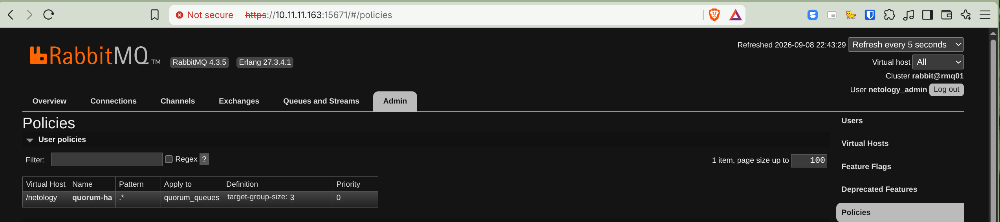
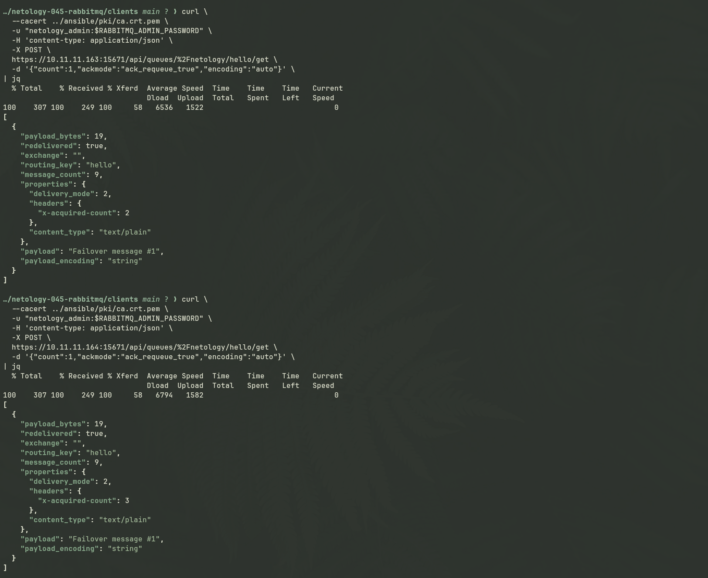
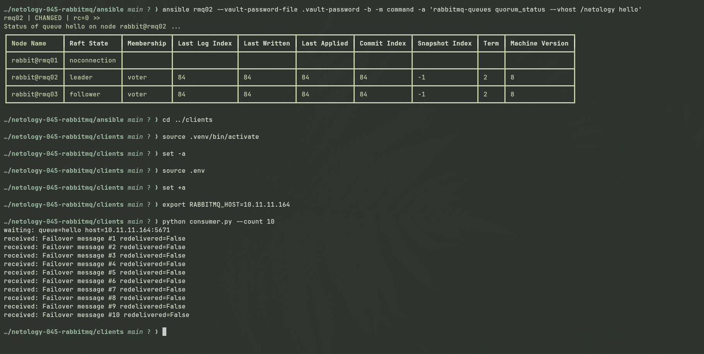

# Домашнее задание к занятию «Очереди RabbitMQ»

Студент: Игорь Мосийчук

Ссылка на задание: [Netology, 11-04.md](https://github.com/netology-code/sdb-homeworks/blob/main/11-04.md)

## Что сделал

Стенд собран на RabbitMQ 4.3.5.

Вместо двух VM из задания поднял три узла. Для `quorum` queue это практичнее: при отказе одной ноды остаётся большинство 2 из 3 и очередь продолжает работать.

VM создаются Terraform в Proxmox. Это только замена Vagrant/VirtualBox из условия. Настройка RabbitMQ выполнена Ansible.

Старую политику `ha-all` не использовал. Она относится к classic mirrored queues из старых версий RabbitMQ. В RabbitMQ 4.x для такого сценария используется `quorum` queue. Поэтому в работе настроена политика `quorum-ha` с `target-group-size: 3`.

Дополнительно включены TLS, отдельный vhost `/netology`, отдельные пользователи для администратора и приложения, а также простой firewall на самих VM. Это не меняет смысл задания, но позволяет потрогать RabbitMQ в более нормальной конфигурации.

Основные файлы:

- [Terraform](terraform/)
- [Ansible playbook](ansible/playbooks/site.yml)
- [роль RabbitMQ](ansible/roles/rabbitmq_cluster/)
- [роль firewall](ansible/roles/rabbitmq_firewall/)
- [producer.py](clients/producer.py)
- [consumer.py](clients/consumer.py)
- [генерация inventory](scripts/render-inventory.sh)
- [генерация тестовой PKI](scripts/generate-lab-pki.sh)

## Задание 1. Установка RabbitMQ

<details>
<summary>Условие задания</summary>

Используя Vagrant или VirtualBox, создайте виртуальную машину и установите RabbitMQ.
Добавьте management plug-in и зайдите в веб-интерфейс.

*Итогом выполнения домашнего задания будет приложенный скриншот веб-интерфейса RabbitMQ.*

</details>

RabbitMQ установлен через Ansible. Веб-интерфейс работает по HTTPS.

На скриншоте видна версия RabbitMQ 4.3.5 и все три ноды кластера.



## Задание 2. Отправка и получение сообщений

<details>
<summary>Условие задания</summary>

Используя приложенные скрипты, проведите тестовую отправку и получение сообщения.
Для отправки сообщений необходимо запустить скрипт producer.py.

Для работы скриптов вам необходимо установить Python версии 3 и библиотеку Pika.
Также в скриптах нужно указать IP-адрес машины, на которой запущен RabbitMQ, заменив localhost на нужный IP.

```shell script
$ pip install pika
```

Зайдите в веб-интерфейс, найдите очередь под названием hello и сделайте скриншот.
После чего запустите второй скрипт consumer.py и сделайте скриншот результата выполнения скрипта

*В качестве решения домашнего задания приложите оба скриншота, сделанных на этапе выполнения.*

Для закрепления материала можете попробовать модифицировать скрипты, чтобы поменять название очереди и отправляемое сообщение.

</details>

Для проверки использованы Python 3, Pika и очередь `hello`. Клиент подключается по AMQPS с проверкой сертификата.

После запуска `producer.py` в очереди было 10 сообщений. Очередь создана как `quorum`, лидер `rabbit@rmq01`, участники `rmq01`, `rmq02`, `rmq03`.



После запуска `consumer.py` все 10 сообщений были получены и подтверждены.



Код:

- [clients/producer.py](clients/producer.py)
- [clients/consumer.py](clients/consumer.py)

## Задание 3. Подготовка HA кластера

<details>
<summary>Условие задания</summary>

Используя Vagrant или VirtualBox, создайте вторую виртуальную машину и установите RabbitMQ.
Добавьте в файл hosts название и IP-адрес каждой машины, чтобы машины могли видеть друг друга по имени.

Пример содержимого hosts файла:
```shell script
$ cat /etc/hosts
192.168.0.10 rmq01
192.168.0.11 rmq02
```
После этого ваши машины могут пинговаться по имени.

Затем объедините две машины в кластер и создайте политику ha-all на все очереди.

*В качестве решения домашнего задания приложите скриншоты из веб-интерфейса с информацией о доступных нодах в кластере и включённой политикой.*

Также приложите вывод команды с двух нод:

```shell script
$ rabbitmqctl cluster_status
```

Для закрепления материала снова запустите скрипт producer.py и приложите скриншот выполнения команды на каждой из нод:

```shell script
$ rabbitmqadmin get queue='hello'
```

После чего попробуйте отключить одну из нод, желательно ту, к которой подключались из скрипта, затем поправьте параметры подключения в скрипте consumer.py на вторую ноду и запустите его.

*Приложите скриншот результата работы второго скрипта.*

</details>

Кластер собран из трёх нод:

```text
rabbit@rmq01
rabbit@rmq02
rabbit@rmq03
```

Имена узлов прописываются Ansible в `/etc/hosts`, поэтому конфигурация собирается из inventory, а не из вручную заданного списка.

Список всех трёх активных нод уже виден на [первом скриншоте](docs/screenshots/01-management-overview.png).

Вместо `ha-all` используется `quorum-ha`:



### `rabbitmqctl cluster_status`

На `rmq01` до отключения ноды:

```text
Cluster status of node rabbit@rmq01 ...

Disk Nodes

rabbit@rmq01
rabbit@rmq02
rabbit@rmq03

Running Nodes

rabbit@rmq01
rabbit@rmq02
rabbit@rmq03
```

На `rmq02` после остановки `rmq01`:

```text
Cluster status of node rabbit@rmq02 ...

Disk Nodes

rabbit@rmq01
rabbit@rmq02
rabbit@rmq03

Running Nodes

rabbit@rmq02
rabbit@rmq03
```

### Получение сообщения через разные ноды

Старая команда `rabbitmqadmin get` из условия не использовалась. Проверка сделана напрямую через Management HTTP API RabbitMQ по HTTPS.

Один и тот же `Failover message #1` был получен через `rmq01` и через `rmq02`.



### Проверка отказа лидера

Перед тестом лидером очереди был `rabbit@rmq01`.

После остановки `rmq01` RabbitMQ выбрал нового лидера:

```text
rabbit@rmq01   unknown
rabbit@rmq02   leader
rabbit@rmq03   follower
term           2
```

После этого `consumer.py` был подключён к `rmq02` и получил все 10 сообщений, опубликованных до отказа первой ноды.



После запуска `rmq01` нода вернулась в quorum как follower.

## Дополнительное задание 4. Ansible playbook

<details>
<summary>Условие задания</summary>

Напишите плейбук, который будет производить установку RabbitMQ на любое количество нод и объединять их в кластер.
При этом будет автоматически создавать политику ha-all.

*Готовый плейбук разместите в своём репозитории.*

</details>

Точка входа: [ansible/playbooks/site.yml](ansible/playbooks/site.yml).

Основная логика находится в [ansible/roles/rabbitmq_cluster](ansible/roles/rabbitmq_cluster/).

Количество узлов берётся из группы `rabbitmq` в inventory. Роль не привязана к трём конкретным именам и может собрать кластер из другого количества нод. Для текущей работы inventory генерируется из Terraform output через [scripts/render-inventory.sh](scripts/render-inventory.sh).

Ansible выполняет:

- установку RabbitMQ 4.3.5;
- настройку имён нод и общей Erlang cookie;
- сборку кластера;
- включение Management Plugin;
- настройку TLS;
- создание vhost `/netology`;
- создание пользователей;
- настройку `quorum-ha`;
- настройку firewall.

Секреты вынесены в Ansible Vault.

Для TLS используется локальная тестовая CA. Сертификаты создаются скриптом [scripts/generate-lab-pki.sh](scripts/generate-lab-pki.sh).

Firewall оставляет доступными клиентские TLS-порты:

```text
5671   AMQPS
15671  Management HTTPS
```

Порты `4369` и `25672` доступны только между RabbitMQ-нодами.
