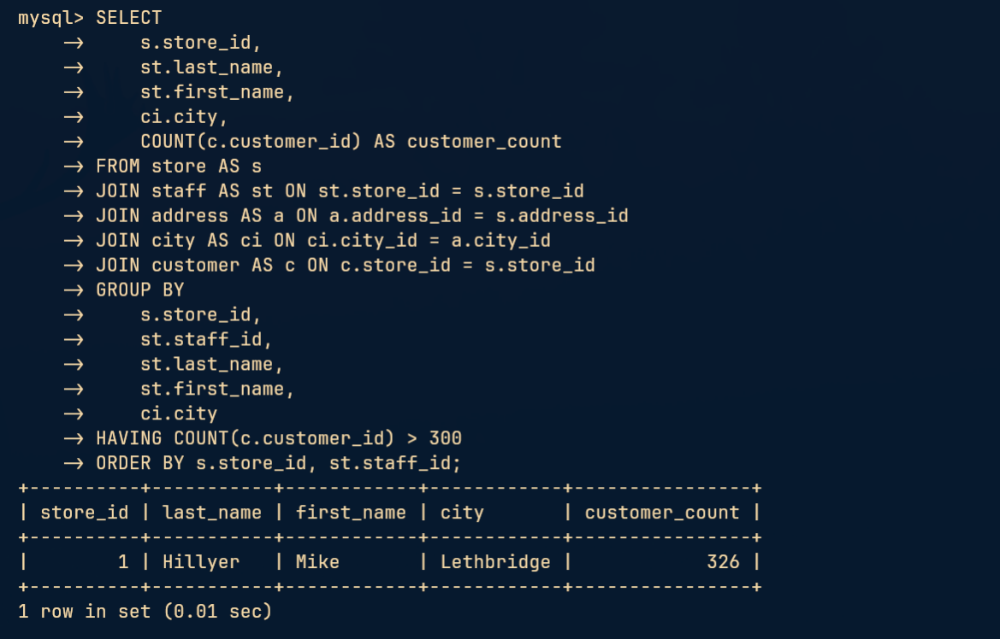
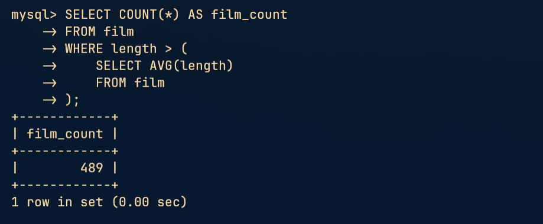
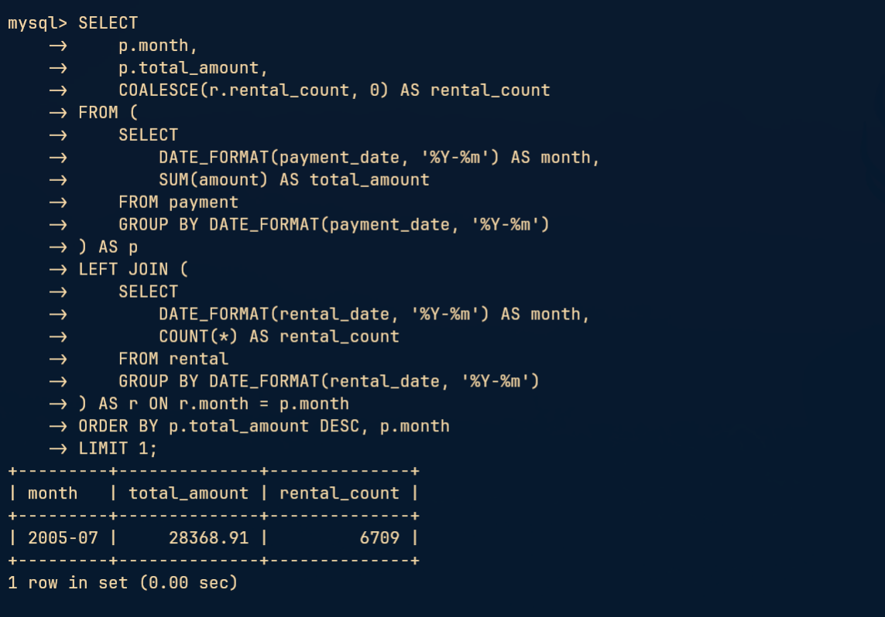
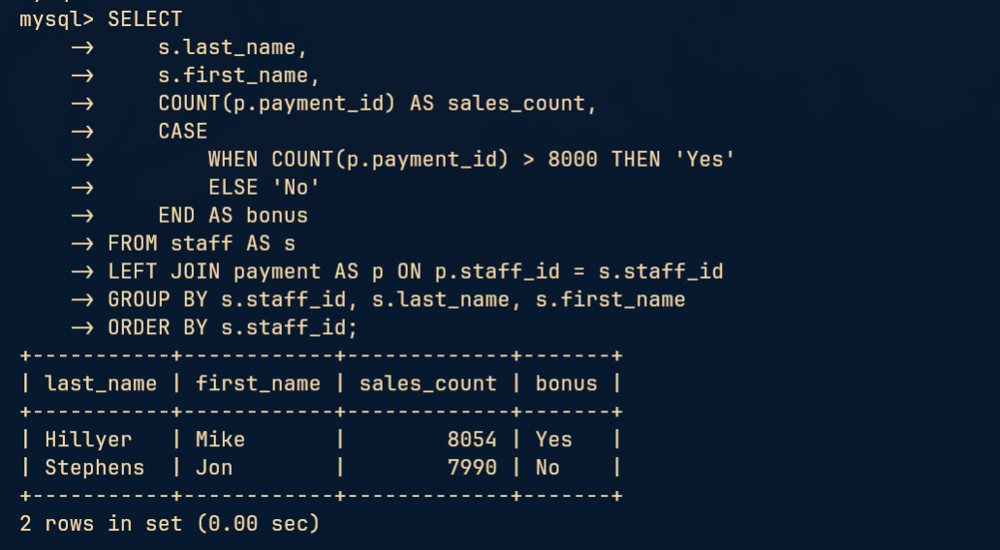
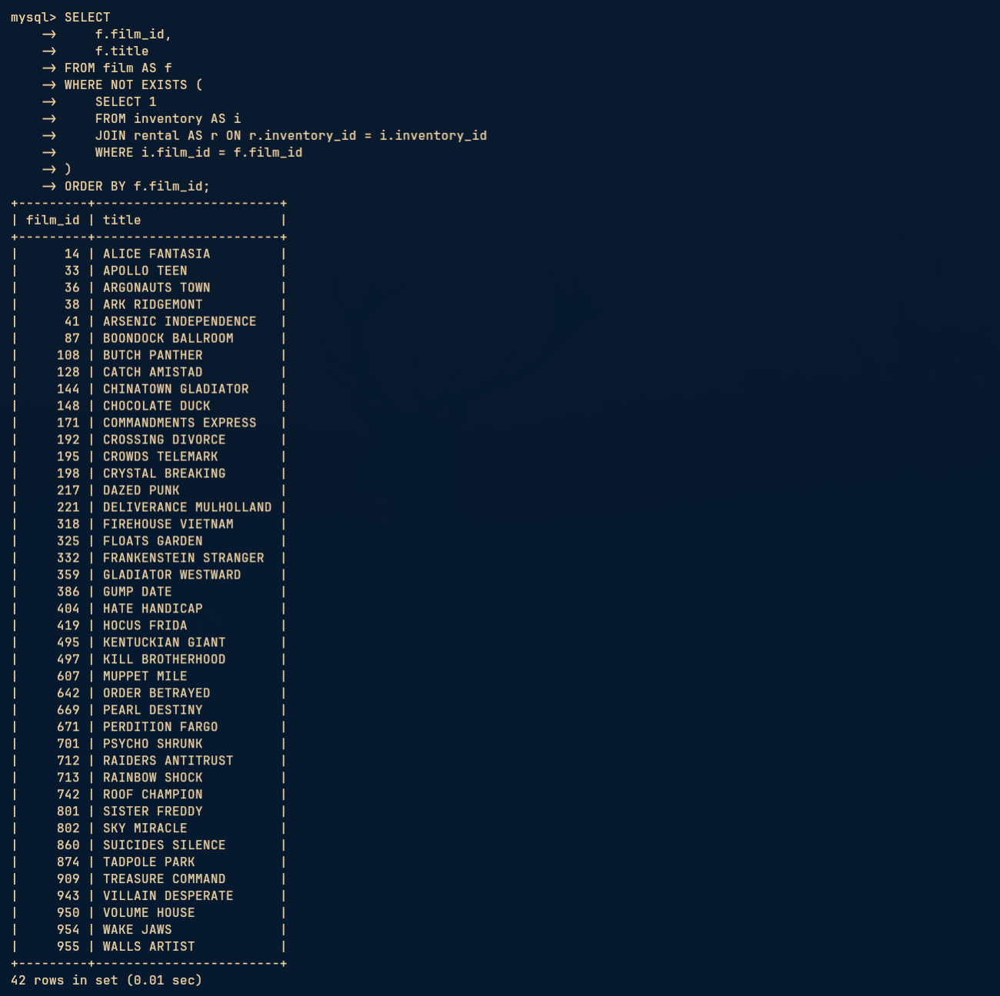

# Домашнее задание к занятию «SQL. Часть 2»

Студент: Игорь Мосийчук

Поднял MySQL 8.4.13 в Docker Compose и восстановил Sakila.

[Конфигурация Compose](compose.yml)

## Задание 1

<details>
<summary>Условие</summary>

Одним запросом получите информацию о магазине, в котором обслуживается более 300 покупателей, и выведите в результат следующую информацию:
- фамилия и имя сотрудника из этого магазина;
- город нахождения магазина;
- количество пользователей, закреплённых в этом магазине.

</details>

### Решение

Получил сотрудника и город магазина, за которым закреплено больше 300 покупателей. Сгруппировал по магазину и сотруднику, чтобы не завысить число покупателей при соединении таблиц. Счётчик сверил с отдельной группировкой `customer` по `store_id`.

```sql
SELECT
    s.store_id,
    st.last_name,
    st.first_name,
    ci.city,
    COUNT(c.customer_id) AS customer_count
FROM store AS s
JOIN staff AS st ON st.store_id = s.store_id
JOIN address AS a ON a.address_id = s.address_id
JOIN city AS ci ON ci.city_id = a.city_id
JOIN customer AS c ON c.store_id = s.store_id
GROUP BY
    s.store_id,
    st.staff_id,
    st.last_name,
    st.first_name,
    ci.city
HAVING COUNT(c.customer_id) > 300
ORDER BY s.store_id, st.staff_id;
```



## Задание 2

<details>
<summary>Условие</summary>

Получите количество фильмов, продолжительность которых больше средней продолжительности всех фильмов.

</details>

### Решение

Посчитал фильмы, продолжительность которых строго больше средней по всему каталогу.

```sql
SELECT COUNT(*) AS film_count
FROM film
WHERE length > (
    SELECT AVG(length)
    FROM film
);
```



## Задание 3

<details>
<summary>Условие</summary>

Получите информацию, за какой месяц была получена наибольшая сумма платежей, и добавьте информацию по количеству аренд за этот месяц.

</details>

### Решение

Отдельно сгруппировал платежи и аренды по году и месяцу, затем соединил месячные результаты. Под количеством аренд учитывал аренды, начатые в этом месяце по `rental_date`, а не оплаченные в нём. Наибольшая сумма платежей получена в июле 2005 года.

```sql
SELECT
    p.month,
    p.total_amount,
    COALESCE(r.rental_count, 0) AS rental_count
FROM (
    SELECT
        DATE_FORMAT(payment_date, '%Y-%m') AS month,
        SUM(amount) AS total_amount
    FROM payment
    GROUP BY DATE_FORMAT(payment_date, '%Y-%m')
) AS p
LEFT JOIN (
    SELECT
        DATE_FORMAT(rental_date, '%Y-%m') AS month,
        COUNT(*) AS rental_count
    FROM rental
    GROUP BY DATE_FORMAT(rental_date, '%Y-%m')
) AS r ON r.month = p.month
ORDER BY p.total_amount DESC, p.month
LIMIT 1;
```



## Задание 4*

<details>
<summary>Условие</summary>

Посчитайте количество продаж, выполненных каждым продавцом. Добавьте вычисляемую колонку «Премия». Если количество продаж превышает 8000, то значение в колонке будет «Да», иначе должно быть значение «Нет».

</details>

### Решение

Посчитал операции оплаты каждого сотрудника и добавил премию при количестве продаж строго больше 8000. `LEFT JOIN` сохраняет сотрудников без продаж, а `COUNT(p.payment_id)` не считает пустую правую строку.

Из-за потери кириллицы использовал `bonus`, `Yes` и `No` вместо `Премия`, `Да` и `Нет`.

```sql
SELECT
    s.last_name,
    s.first_name,
    COUNT(p.payment_id) AS sales_count,
    CASE
        WHEN COUNT(p.payment_id) > 8000 THEN 'Yes'
        ELSE 'No'
    END AS bonus
FROM staff AS s
LEFT JOIN payment AS p ON p.staff_id = s.staff_id
GROUP BY s.staff_id, s.last_name, s.first_name
ORDER BY s.staff_id;
```



## Задание 5*

<details>
<summary>Условие</summary>

Найдите фильмы, которые ни разу не брали в аренду.

</details>

### Решение

Выбрал фильмы, для которых не существует ни одной аренды ни одной копии. Запрос также учитывает фильмы без экземпляров в `inventory`.

```sql
SELECT
    f.film_id,
    f.title
FROM film AS f
WHERE NOT EXISTS (
    SELECT 1
    FROM inventory AS i
    JOIN rental AS r ON r.inventory_id = i.inventory_id
    WHERE i.film_id = f.film_id
)
ORDER BY f.film_id;
```


