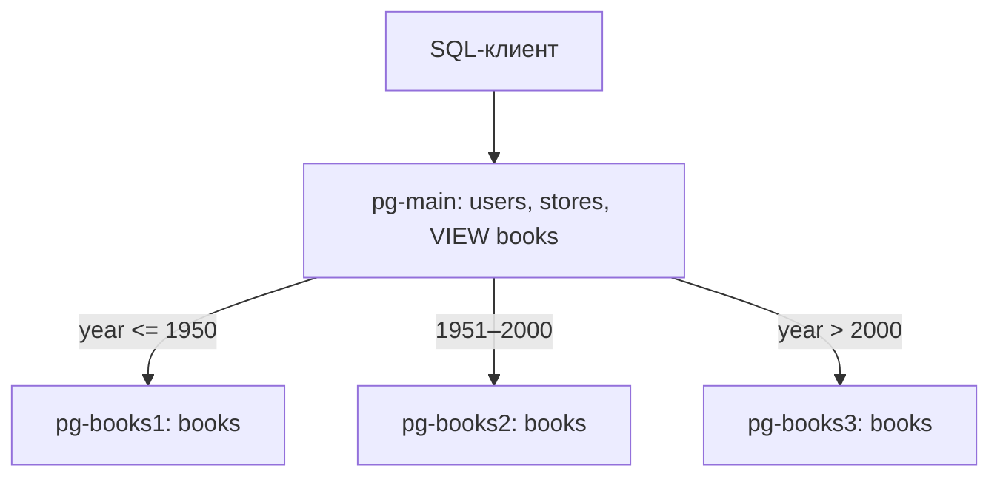

# Домашнее задание к занятию «Репликация и масштабирование. Часть 2»

Студент: Игорь Мосийчук

## Задание 1

<details>
<summary>Условие</summary>

Опишите основные преимущества использования масштабирования методами:

- активный master-сервер и пассивный репликационный slave-сервер;
- master-сервер и несколько slave-серверов.

*Дайте ответ в свободной форме.*

</details>

### Решение

**Master + пассивная реплика.** Основной сервер обрабатывает запросы, а реплика хранит копию данных на случай аварии. Если master упадёт, на реплику можно переключиться и быстрее восстановить работу. Само переключение нужно настроить отдельно. При асинхронной репликации последние записи могут не успеть скопироваться.

**Master + несколько реплик.** Запись идёт на master, а чтение можно распределить между репликами. Например, отправить отчёты на отдельный сервер и разгрузить основную БД. Но запись по-прежнему упирается в master, а данные на репликах могут немного отставать.

Репликация не заменяет бэкапы: ошибочное удаление данных тоже разойдётся по репликам.

## Задание 2

<details>
<summary>Условие</summary>

Разработайте план для выполнения горизонтального и вертикального шаринга базы данных. База данных состоит из трёх таблиц:

- пользователи,
- книги,
- магазины (столбцы произвольно).

Опишите принципы построения системы и их разграничение или разбивку между базами данных.

*Пришлите блоксхему, где и что будет располагаться. Опишите, в каких режимах будут работать сервера.*

</details>

### Решение

Для примера взял четыре PostgreSQL:

- `pg-main` — таблицы `users`, `stores` и общее представление `books`.
- `pg-books1` — книги, выпущенные до 1951 года.
- `pg-books2` — книги за 1951–2000 годы.
- `pg-books3` — книги после 2000 года.

**Вертикальное разделение:** пользователей и магазины оставил на `pg-main`, а хранение книг вынес на другие серверы. То есть разные таблицы лежат в разных базах.

**Горизонтальное разделение:** сами книги разбил по строкам — в зависимости от года выпуска (`year`).



Все серверы работают на чтение и запись, но клиенту достаточно подключаться к `pg-main`. Тот обращается к шардам через `postgres_fdw`: чтение объединяет `VIEW books`, а `INSERT` распределяют правила `CREATE RULE`.

## Задание 3*

<details>
<summary>Условие</summary>

Выполните настройку выбранных методов шардинга из задания 2.

*Пришлите конфиг Docker и SQL скрипт с командами для базы данных.*

</details>

### Решение

В Compose четыре PostgreSQL. При первом запуске SQL-файлы создают таблицы, внешние подключения и правила распределения. 
Данные добавляются отдельно: вставляем книги в одну `VIEW books` на `pg-main`, а PostgreSQL сам отправляет строки на нужные серверы.

Файлы:

- [compose.yml](compose.yml) — контейнеры и тома.
- [sql/main/init.sql](sql/main/init.sql) — таблицы, `postgres_fdw`, `VIEW` и правила `INSERT`.
- [sql/books1/init.sql](sql/books1/init.sql), [sql/books2/init.sql](sql/books2/init.sql), [sql/books3/init.sql](sql/books3/init.sql) — таблица `books` на каждом шарде с ограничением по году.
- [sql/seed.sql](sql/seed.sql) — тестовые данные.
- [env.sample](env.sample) — пример переменных окружения.

### Запуск

```bash
cp env.sample .env
micro .env
docker compose config -q
docker compose up -d
docker compose ps
```

В `.env` нужно задать свой `POSTGRES_PASSWORD`. После запуска контейнеров добавляем данные:

```bash
docker compose exec -T pg-main psql -U lab -d library -v ON_ERROR_STOP=1 -f /work/sql/seed.sql
```

### Проверка

Сначала смотрим все книги через общую точку входа:

```bash
docker compose exec -T pg-main psql -U lab -d library -c 'SELECT id, title, year FROM books ORDER BY year, id;'
```

Потом проверяем, где они лежат физически:

```bash
docker compose exec -T pg-books1 psql -U lab -d library -c 'TABLE books;'
docker compose exec -T pg-books2 psql -U lab -d library -c 'TABLE books;'
docker compose exec -T pg-books3 psql -U lab -d library -c 'TABLE books;'
```

В каждом шарде стоит `CHECK` по году, поэтому книгу с неподходящим годом напрямую туда не записать.

Настроено распределение только для `INSERT`.
Связь `books.store_id` с таблицей `stores` логическая: внешний ключ между разными серверами не задан.

SQL из `/docker-entrypoint-initdb.d` выполняется только при создании пустого тома. Повторный запуск `seed.sql` на заполненной базе выдаст ошибку из-за повторяющихся `id`.
