# Домашнее задание к занятию 4 «Оркестрация группой Docker контейнеров на примере Docker Compose»

Студент: Игорь Мосийчук

Выполнил на Linux с Docker Engine 29.9.3 и Docker Compose 5.7.1. В задачах 2 и 3 использовал порт хоста `8090` вместо `8080`: исходный порт занят рабочим сервисом. Внутренний порт контейнера при запуске оставил `80`.

## Задача 1

<details>
<summary>Условие</summary>


Сценарий выполнения задачи:
- Установите docker и docker compose plugin на свою linux рабочую станцию или ВМ.
- Если dockerhub недоступен создайте файл /etc/docker/daemon.json с содержимым: ```{"registry-mirrors": ["https://mirror.gcr.io", "https://daocloud.io", "https://c.163.com/", "https://registry.docker-cn.com"]}```
- Зарегистрируйтесь и создайте публичный репозиторий  с именем "custom-nginx" на https://hub.docker.com (ТОЛЬКО ЕСЛИ У ВАС ЕСТЬ ДОСТУП);
- скачайте образ nginx:1.29.0;
- Создайте Dockerfile и реализуйте в нем замену дефолтной индекс-страницы(/usr/share/nginx/html/index.html), на файл index.html с содержимым:
```
<html>
<head>
Hey, Netology
</head>
<body>
<h1>I will be DevOps Engineer!</h1>
</body>
</html>
```
- Соберите и отправьте созданный образ в свой dockerhub-репозитории c tag 1.0.0 (ТОЛЬКО ЕСЛИ ЕСТЬ ДОСТУП). 
- Предоставьте ответ в виде ссылки на https://hub.docker.com/<username_repo>/custom-nginx/general .

</details>

### Решение

Собрал образ по [Dockerfile](Dockerfile) с собственной [index.html](index.html) и опубликовал его в Docker Hub. Права страницы заданы через `COPY --chmod=0644`.

```bash
docker build -t custom-nginx:1.0.0 .
docker tag custom-nginx:1.0.0 51kuga/custom-nginx:1.0.0
docker push 51kuga/custom-nginx:1.0.0
```

Образ: [51kuga/custom-nginx:1.0.0](https://hub.docker.com/r/51kuga/custom-nginx).

## Задача 2

<details>
<summary>Условие</summary>

1. Запустите ваш образ custom-nginx:1.0.0 командой docker run в соответвии с требованиями:
- имя контейнера "ФИО-custom-nginx-t2"
- контейнер работает в фоне
- контейнер опубликован на порту хост системы 127.0.0.1:8080
2. Не удаляя, переименуйте контейнер в "custom-nginx-t2"
3. Выполните команду ```date +"%d-%m-%Y %T.%N %Z" ; sleep 0.150 ; docker ps ; ss -tlpn | grep 127.0.0.1:8080  ; docker logs custom-nginx-t2 -n1 ; docker exec -it custom-nginx-t2 base64 /usr/share/nginx/html/index.html```
4. Убедитесь с помощью curl или веб браузера, что индекс-страница доступна.

В качестве ответа приложите скриншоты консоли, где видно все введенные команды и их вывод.

</details>

### Решение

Запустил образ через `docker run -d` с публикацией `127.0.0.1:8090:80`, затем без пересоздания переименовал контейнер в `custom-nginx-t2`. Страница доступна с хоста. [compose.yaml](compose.yaml) содержит отдельный вариант запуска через Compose.

### Проверка

```bash
docker port custom-nginx-t2
curl -f http://127.0.0.1:8090
```

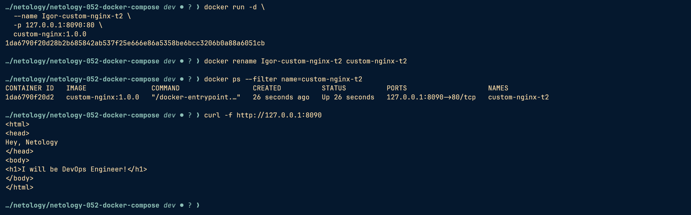

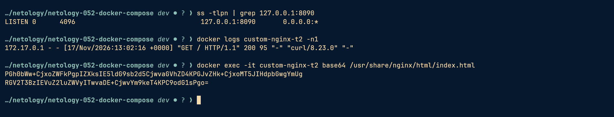

## Задача 3

<details>
<summary>Условие</summary>

1. Воспользуйтесь docker help или google, чтобы узнать как подключиться к стандартному потоку ввода/вывода/ошибок контейнера "custom-nginx-t2".
2. Подключитесь к контейнеру и нажмите комбинацию Ctrl-C.
3. Выполните ```docker ps -a``` и объясните своими словами почему контейнер остановился.
4. Перезапустите контейнер
5. Зайдите в интерактивный терминал контейнера "custom-nginx-t2" с оболочкой bash.
6. Установите любимый текстовый редактор(vim, nano итд) с помощью apt-get.
7. Отредактируйте файл "/etc/nginx/conf.d/default.conf", заменив порт "listen 80" на "listen 81".
8. Запомните(!) и выполните команду ```nginx -s reload```, а затем внутри контейнера ```curl http://127.0.0.1:80 ; curl http://127.0.0.1:81```.
9. Выйдите из контейнера, набрав в консоли  ```exit``` или Ctrl-D.
10. Проверьте вывод команд: ```ss -tlpn | grep 127.0.0.1:8080``` , ```docker port custom-nginx-t2```, ```curl http://127.0.0.1:8080```. Кратко объясните суть возникшей проблемы.
11. * Это дополнительное, необязательное задание. Попробуйте самостоятельно исправить конфигурацию контейнера, используя доступные источники в интернете. Не изменяйте конфигурацию nginx и не удаляйте контейнер. Останавливать контейнер можно. [пример источника](https://www.baeldung.com/linux/assign-port-docker-container)
12. Удалите запущенный контейнер "custom-nginx-t2", не останавливая его.(воспользуйтесь --help или google)

В качестве ответа приложите скриншоты консоли, где видно все введенные команды и их вывод.

</details>

### Решение

Подключился через `docker attach custom-nginx-t2` и нажал Ctrl-C. Nginx получил SIGINT и завершился; контейнер остановился с кодом `0`.

Запустил тот же контейнер, вошёл через `docker exec -it custom-nginx-t2 bash` и в Nano заменил порт на `81` в IPv4- и IPv6-директивах `listen`. Проверил конфигурацию и выполнил `nginx -s reload`. Внутри контейнера порт `80` перестал отвечать, на `81` вернулась страница.

Правило Docker осталось `8090 → 80`, поэтому запрос с хоста завершился ошибкой `Connection reset by peer`. Изменение конфигурации Nginx не меняет публикацию Docker. Необязательный пункт 11 не выполнял. Работающий контейнер удалил командой `docker rm -f custom-nginx-t2`.

### Проверка

```bash
nginx -t
nginx -s reload
curl http://127.0.0.1:80
curl http://127.0.0.1:81
```

Команды выше выполнял внутри контейнера. На хосте проверил `docker port custom-nginx-t2` и `curl --max-time 5 http://127.0.0.1:8090`.

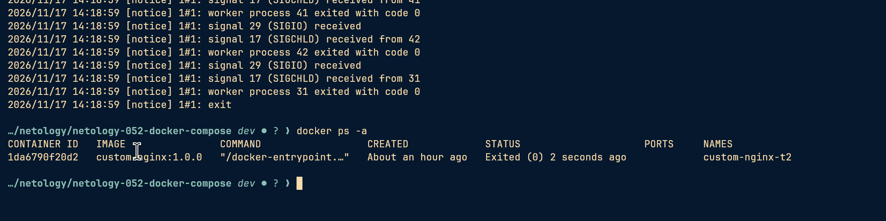

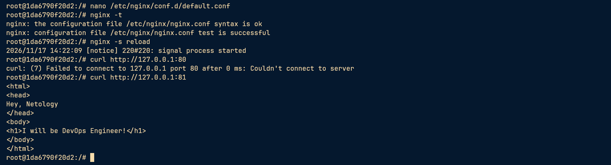

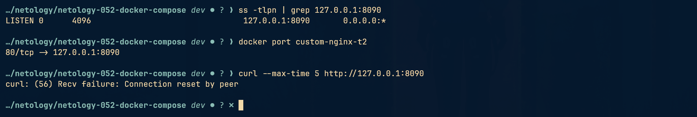

## Задача 4

<details>
<summary>Условие</summary>


- Запустите первый контейнер из образа ***centos*** c любым тегом в фоновом режиме, подключив папку  текущий рабочий каталог ```$(pwd)``` на хостовой машине в ```/data``` контейнера, используя ключ -v.
- Запустите второй контейнер из образа ***debian*** в фоновом режиме, подключив текущий рабочий каталог ```$(pwd)``` в ```/data``` контейнера. 
- Подключитесь к первому контейнеру с помощью ```docker exec``` и создайте текстовый файл любого содержания в ```/data```.
- Добавьте ещё один файл в текущий каталог ```$(pwd)``` на хостовой машине.
- Подключитесь во второй контейнер и отобразите листинг и содержание файлов в ```/data``` контейнера.


В качестве ответа приложите скриншоты консоли, где видно все введенные команды и их вывод.

</details>

### Решение

Запустил CentOS Stream 9 и Debian с общим текущим каталогом хоста, подключённым в `/data`. Создал `from-centos.txt` из CentOS и `from-host.txt` на хосте. Оба файла и их содержимое доступны в Debian.

```bash
docker run -d --name task4-centos -v "$PWD:/data:z" quay.io/centos/centos:stream9 sleep infinity
docker run -d --name task4-debian -v "$PWD:/data:z" debian:bookworm-slim sleep infinity
docker exec task4-centos sh -c 'echo "from centos" > /data/from-centos.txt'
echo "from host" > from-host.txt
```

### Проверка

```bash
docker exec task4-debian ls -l /data
docker exec task4-debian cat /data/from-centos.txt /data/from-host.txt
```

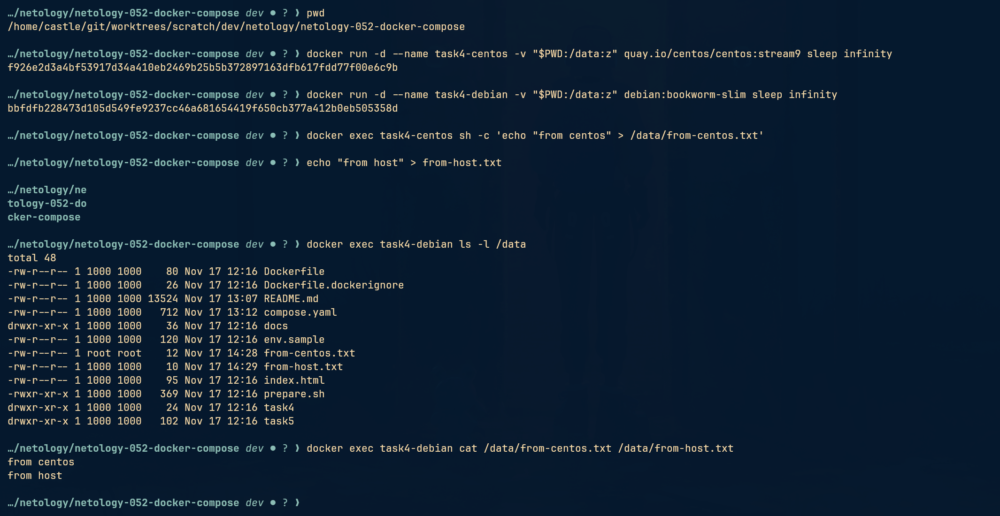

## Задача 5

<details>
<summary>Условие</summary>


1. Создайте отдельную директорию(например /tmp/netology/docker/task5) и 2 файла внутри него.
"compose.yaml" с содержимым:
```
version: "3"
services:
  portainer:
    network_mode: host
    image: portainer/portainer-ce:latest
    volumes:
      - /var/run/docker.sock:/var/run/docker.sock
```
"docker-compose.yaml" с содержимым:
```
version: "3"
services:
  registry:
    image: registry:2

    ports:
    - "5000:5000"
```

И выполните команду "docker compose up -d". Какой из файлов был запущен и почему? (подсказка: https://docs.docker.com/compose/compose-application-model/#the-compose-file )

2. Отредактируйте файл compose.yaml так, чтобы были запущенны оба файла. (подсказка: https://docs.docker.com/compose/compose-file/14-include/)

3. Выполните в консоли вашей хостовой ОС необходимые команды чтобы залить образ custom-nginx как custom-nginx:latest в запущенное вами, локальное registry. Дополнительная документация: https://distribution.github.io/distribution/about/deploying/
4. Откройте страницу "https://127.0.0.1:9000" и произведите начальную настройку portainer.(логин и пароль адмнистратора)
5. Откройте страницу "http://127.0.0.1:9000/#!/home", выберите ваше local  окружение. Перейдите на вкладку "stacks" и в "web editor" задеплойте следующий компоуз:

```
version: '3'

services:
  nginx:
    image: 127.0.0.1:5000/custom-nginx
    ports:
      - "9090:80"
```
6. Перейдите на страницу "http://127.0.0.1:9000/#!/2/docker/containers", выберите контейнер с nginx и нажмите на кнопку "inspect". В представлении <> Tree разверните поле "Config" и сделайте скриншот от поля "AppArmorProfile" до "Driver".

7. Удалите любой из манифестов компоуза(например compose.yaml).  Выполните команду "docker compose up -d". Прочитайте warning, объясните суть предупреждения и выполните предложенное действие. Погасите compose-проект ОДНОЙ(обязательно!!) командой.

В качестве ответа приложите скриншоты консоли, где видно все введенные команды и их вывод, файл compose.yaml , скриншот portainer c задеплоенным компоузом.

---

### Правила приема

Домашнее задание выполните в файле readme.md в GitHub-репозитории. В личном кабинете отправьте на проверку ссылку на .md-файл в вашем репозитории.

</details>

### Решение

В отдельном каталоге использовал копии [compose.yaml](task5/compose.yaml) и [docker-compose.yaml](task5/docker-compose.yaml). Сначала убрал `include`: Compose выбрал `compose.yaml` и запустил только Portainer. Затем вернул `include` и запустил Registry в том же проекте `netology-052-discovery`.

Вместо `latest` использовал Portainer CE `2.45.3`. Порты панели и Registry опубликовал только на loopback, без `network_mode: host`. Portainer получает административный доступ к Engine через Docker socket, в том числе при mount с `:ro`.

HTTPS-панель открыл на `https://127.0.0.1:9443`, создал администратора и подключился к local environment. Адрес `https://127.0.0.1:9000` из условия не соответствует протоколу этого порта: `9000` используется для HTTP.

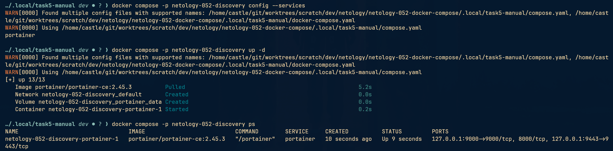

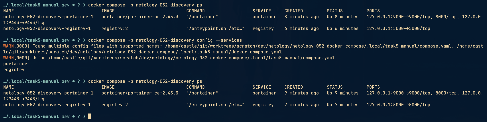

Отправил образ в локальный Registry:

```bash
docker tag custom-nginx:1.0.0 127.0.0.1:5000/custom-nginx:latest
docker push 127.0.0.1:5000/custom-nginx:latest
curl -f http://127.0.0.1:5000/v2/_catalog
```

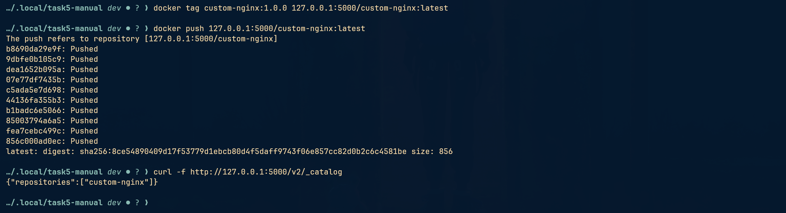

Через Web editor создал stack `netology052-nginx` по [манифесту](task5/portainer-nginx.yaml). Контейнер `task5-nginx-deployed` использует образ из локального Registry. Запрос `curl -f http://127.0.0.1:9090` вернул страницу задания.

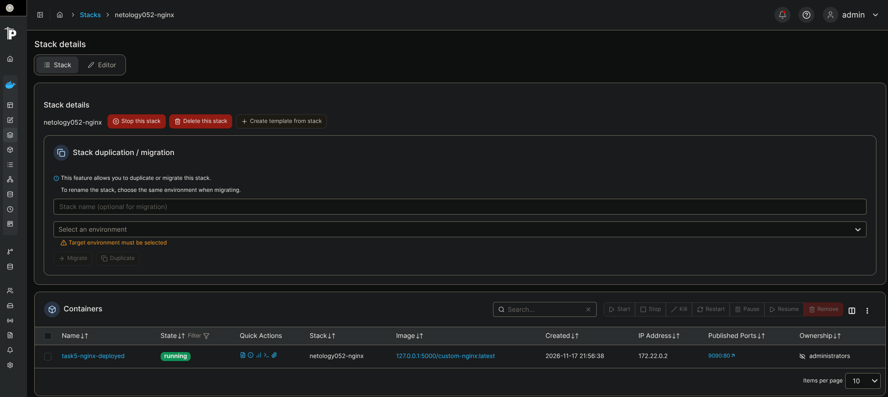

### Проверка

```bash
docker compose -p netology-052-discovery config --services
docker compose -p netology-052-discovery ps
```

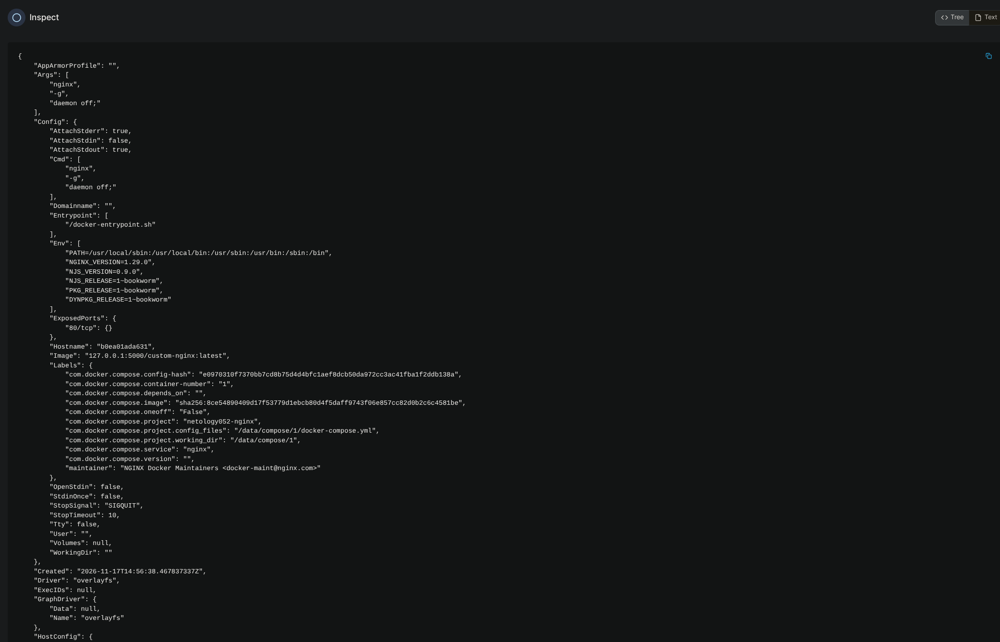

После удаления основного `compose.yaml` из рабочей копии Compose выбрал оставшийся файл с Registry. Portainer стал orphan: контейнер принадлежит тому же проекту, но его сервиса уже нет в текущем манифесте. Получил предупреждение и удалил оба контейнера и сеть одной командой:

```bash
docker compose -p netology-052-discovery down --remove-orphans
```

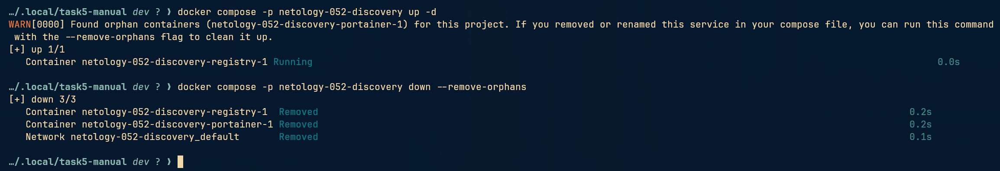
