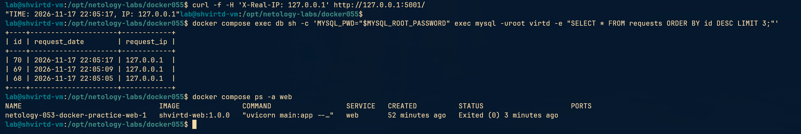
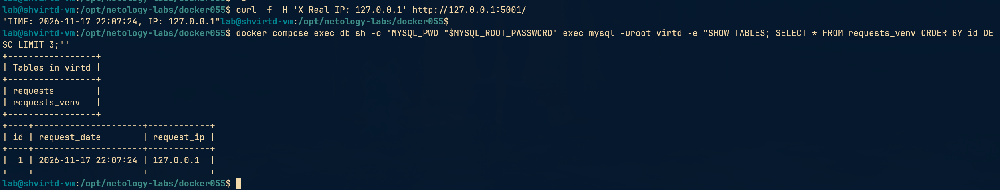
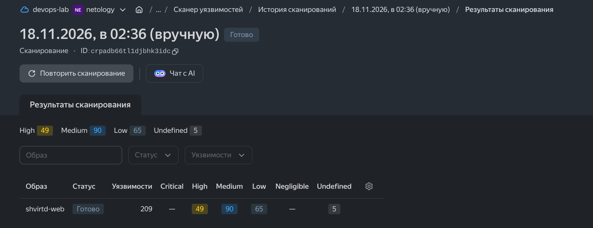
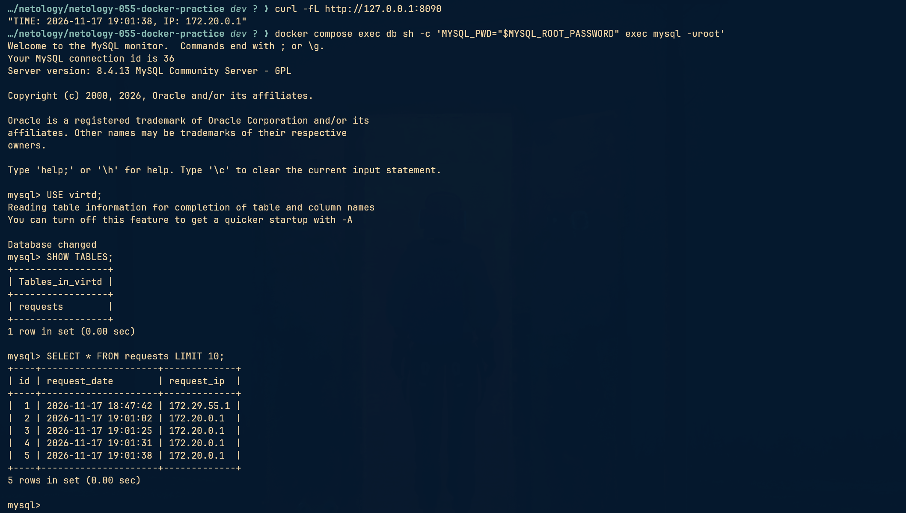
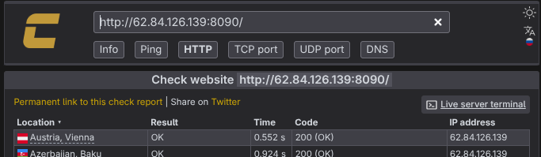
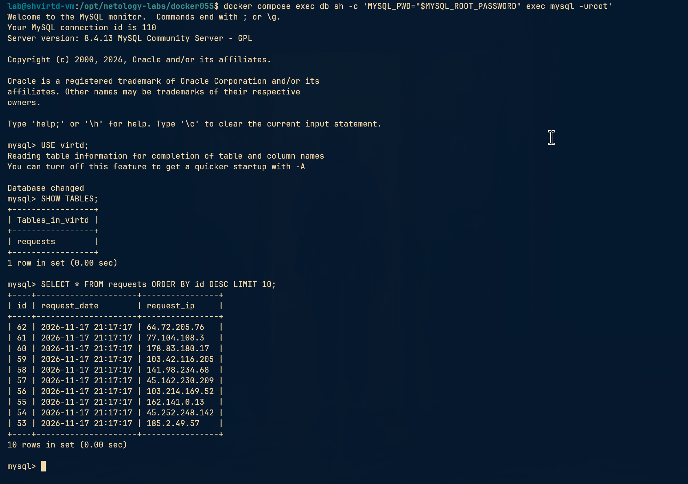
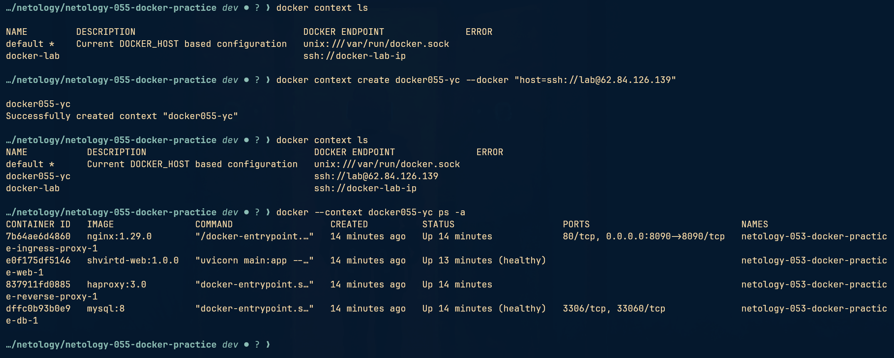
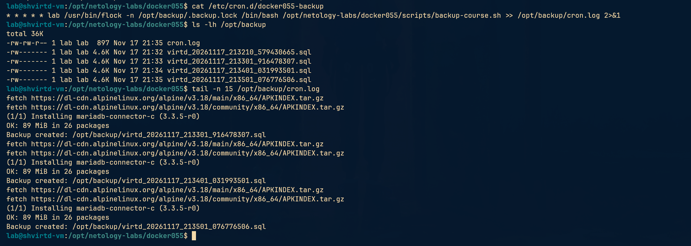
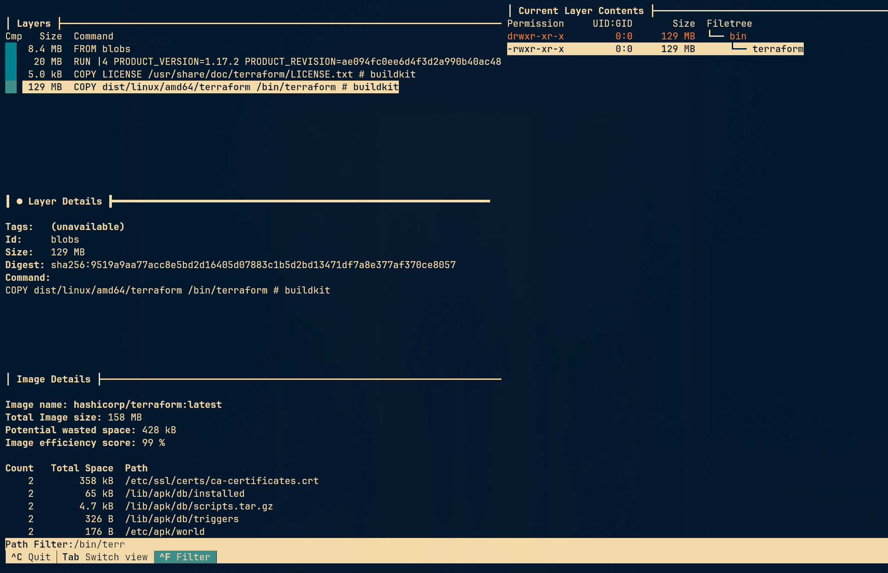
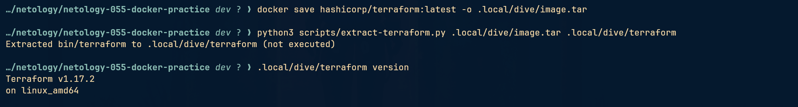

# Домашнее задание к занятию 5. «Практическое применение Docker»

Студент: Игорь Мосийчук

## Задача 1

<details>
<summary>Условие</summary>

1. Сделайте в своем GitHub пространстве fork [репозитория](https://github.com/netology-code/shvirtd-example-python).

2. Создайте файл ```Dockerfile.python``` на основе существующего `Dockerfile`:
   - Используйте базовый образ ```python:3.12-slim```
   - Обязательно используйте конструкцию ```COPY . .``` в Dockerfile
   - Создайте `.dockerignore` файл для исключения ненужных файлов
   - Используйте ```CMD ["uvicorn", "main:app", "--host", "0.0.0.0", "--port", "5000"]``` для запуска
   - Протестируйте корректность сборки
2.1 Используйте multistage сборку вместо single stage.
3. (Необязательная часть, *) Изучите инструкцию в проекте и запустите web-приложение без использования docker, с помощью venv. (Mysql БД можно запустить в docker run).
4. (Необязательная часть, *) Изучите код приложения и добавьте управление названием таблицы через ENV переменную.
---
### ВНИМАНИЕ!
!!! В процессе последующего выполнения ДЗ НЕ изменяйте содержимое файлов в fork-репозитории! Ваша задача ДОБАВИТЬ 5 файлов: ```Dockerfile.python```, ```compose.yaml```, ```.gitignore```, ```.dockerignore```,```bash-скрипт```. Если вам понадобилось внести иные изменения в проект - вы что-то делаете неверно!
---

</details>

### Решение

Собрал образ с multistage: [Dockerfile.python](Dockerfile.python), [.dockerignore](.dockerignore).

Структуру проекта немного изменил под свои эксперименты: приложение лежит в [source/](source/), дополнительные варианты отдельно.

```bash
docker build --progress=plain -f Dockerfile.python -t shvirtd-web:1.0.0 .
```

#### Запуск без Docker (*)

Запустил приложение через venv на облачной VM, MySQL оставил в контейнере.



#### Название таблицы через ENV (*)

Добавил [DB_TABLE](examples/table-env/main.py) и запустил с `DB_TABLE=requests_venv`. Запросы пошли в отдельную таблицу.



## Задача 2 (*)

<details>
<summary>Условие</summary>

1. Создайте в yandex cloud container registry с именем "test" с помощью "yc tool" . [Инструкция](https://cloud.yandex.ru/ru/docs/container-registry/quickstart/?from=int-console-help)
2. Настройте аутентификацию вашего локального docker в yandex container registry.
3. Соберите и залейте в него образ с python приложением из задания №1.
4. Просканируйте образ на уязвимости.
5. В качестве ответа приложите отчет сканирования.

</details>

### Решение

Залил `shvirtd-web:1.0.0` в registry `test` и просканировал образ. [Отчёт сканирования](docs/reports/task-02-vulnerabilities.json).

С push помог `--platform linux/amd64`: без него получал `Cannot read manifest data`.



## Задача 3

<details>
<summary>Условие</summary>

1. Изучите файл "proxy.yaml"
2. Создайте в репозитории с проектом файл ```compose.yaml```. С помощью директивы "include" подключите к нему файл "proxy.yaml".
3. Опишите в файле ```compose.yaml``` следующие сервисы: 

- ```web```. Образ приложения должен ИЛИ собираться при запуске compose из файла ```Dockerfile.python``` ИЛИ скачиваться из yandex cloud container registry(из задание №2 со *). Контейнер должен работать в bridge-сети с названием ```backend``` и иметь фиксированный ipv4-адрес ```172.20.0.5```. Сервис должен всегда перезапускаться в случае ошибок.
Передайте необходимые ENV-переменные для подключения к Mysql базе данных по сетевому имени сервиса ```web``` 

- ```db```. image=mysql:8. Контейнер должен работать в bridge-сети с названием ```backend``` и иметь фиксированный ipv4-адрес ```172.20.0.10```. Явно перезапуск сервиса в случае ошибок. Передайте необходимые ENV-переменные для создания: пароля root пользователя, создания базы данных, пользователя и пароля для web-приложения.Обязательно используйте уже существующий .env file для назначения секретных ENV-переменных!

2. Запустите проект локально с помощью docker compose , добейтесь его стабильной работы: команда ```curl -L http://127.0.0.1:8090``` должна возвращать в качестве ответа время и локальный IP-адрес. Если сервисы не стартуют воспользуйтесь командами: ```docker ps -a ``` и ```docker logs <container_name>``` . Если вместо IP-адреса вы получаете информационную ошибку --убедитесь, что вы шлете запрос на порт ```8090```, а не 5000.

5. Подключитесь к БД mysql с помощью команды ```docker exec -ti <имя_контейнера> mysql -uroot -p<пароль root-пользователя>```(обратите внимание что между ключем -u и логином root нет пробела. это важно!!! тоже самое с паролем) . Введите последовательно команды (не забываем в конце символ ; ): ```show databases; use <имя вашей базы данных(по-умолчанию virtd, как это указано в .env)>; show tables; SELECT * from requests LIMIT 10;```. Примечание: таблица в БД создается после первого поступившего запроса к приложению.

6. Остановите проект. В качестве ответа приложите скриншот sql-запроса.

</details>

### Решение

Поднял стек по [compose.yaml](compose.yaml), [proxy.yaml](proxy.yaml) подключил через `include`. HTTP-запрос проходит через Nginx и HAProxy до приложения, запись попадает в MySQL.

Для БД указал `DB_HOST=db`, в условии опечатка с `web`. Параметры подключения вынес в `.env`, формат есть в [env.sample](env.sample).

```sql
SHOW DATABASES;
USE virtd;
SHOW TABLES;
SELECT * FROM requests LIMIT 10;
```

Первая запись на скрине от раннего запуска в подсети `172.29.55.0/24`, остальные уже из `172.20.0.0/24` по заданию.



## Задача 4

<details>
<summary>Условие</summary>

1. Запустите в Yandex Cloud ВМ (вам хватит 2 Гб Ram).
2. Подключитесь к Вм по ssh и установите docker.
3. Напишите bash-скрипт, который скачает ваш fork-репозиторий в каталог /opt и запустит проект целиком.
4. Зайдите на сайт проверки http подключений, например(или аналогичный): ```https://check-host.net/check-http``` и запустите проверку вашего сервиса ```http://<внешний_IP-адрес_вашей_ВМ>:8090```. Таким образом трафик будет направлен в ingress-proxy. Трафик должен пройти через цепочки: Пользователь → Internet → Nginx → HAProxy → FastAPI(запись в БД) → HAProxy → Nginx → Internet → Пользователь
5. (Необязательная часть) Дополнительно настройте remote ssh context к вашему серверу. Отобразите список контекстов и результат удаленного выполнения ```docker ps -a```
6. Повторите SQL-запрос на сервере и приложите скриншот и ссылку на fork.

</details>

### Решение

Поднял VM в Yandex Cloud через [Terraform](terraform/). Проект передал архивом по SCP вместо `git clone` и развернул в `/opt/netology-labs/docker055`, для разового запуска так проще.

Для внешней проверки задал `PUBLISH_HOST=0.0.0.0` и разрешил порт 8090 в security group.

Внешняя проверка `http://62.84.126.139:8090/`:



В БД появились запросы с IP внешних узлов:



Удалённый доступ к Docker через SSH-контекст:

```bash
docker context create docker055-yc --docker "host=ssh://lab@62.84.126.139"
docker context ls
docker --context docker055-yc ps -a
```



## Задача 5 (*)

<details>
<summary>Условие</summary>

1. Напишите и задеплойте на вашу облачную ВМ bash скрипт, который произведет резервное копирование БД mysql в директорию "/opt/backup" с помощью запуска в сети "backend" контейнера из образа ```schnitzler/mysqldump``` при помощи ```docker run ...``` команды. Подсказка: "документация образа."
2. Протестируйте ручной запуск
3. Настройте выполнение скрипта раз в 1 минуту через cron, crontab или systemctl timer. Придумайте способ не светить логин/пароль в git!!
4. Предоставьте скрипт, cron-task и скриншот с несколькими резервными копиями в "/opt/backup"

</details>

### Решение

Сделал [backup-скрипт](scripts/backup-course.sh) через `schnitzler/mysqldump` и поставил в cron раз в минуту. Дампы складываются в `/opt/backup`, пароль берётся из локального env-файла, которого нет в репозитории.

Строка в `/etc/cron.d/docker055-backup`:

```cron
* * * * * lab /usr/bin/flock -n /opt/backup/.backup.lock /bin/bash /opt/netology-labs/docker055/scripts/backup-course.sh >>/opt/backup/cron.log 2>&1
```

Для подключения к MySQL 8.4 понадобился пакет `mariadb-connector-c`, добавил его в запуск контейнера.



Заодно локально попробовал восстановить дамп в отдельную БД и сверил записи.

## Задача 6

<details>
<summary>Условие</summary>

Скачайте docker образ ```hashicorp/terraform:latest``` и скопируйте бинарный файл ```/bin/terraform``` на свою локальную машину, используя dive и docker save.
Предоставьте скриншоты  действий .

</details>

### Решение

В Dive нашёл слой с `/bin/terraform`:



Вручную можно распаковать архив `docker save`, а затем нужный слой через `tar` и забрать `bin/terraform`. Я для интереса собрал с ИИ [скрипт](scripts/extract-terraform.py), который достаёт бинарник из архива сразу.

```bash
mkdir -p .local/dive
docker pull --platform linux/amd64 hashicorp/terraform:latest
dive hashicorp/terraform:latest
docker save hashicorp/terraform:latest -o .local/dive/image.tar
python3 scripts/extract-terraform.py .local/dive/image.tar .local/dive/terraform
.local/dive/terraform version
```

Запустил полученный бинарник: `Terraform v1.17.2`.


